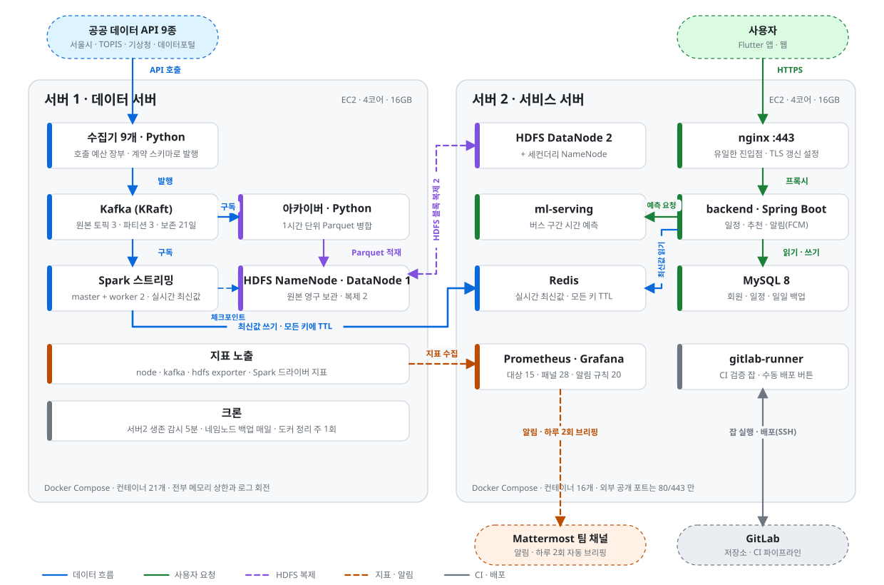
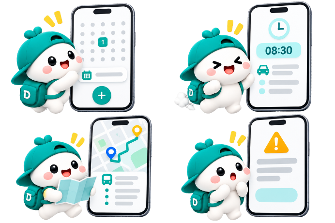
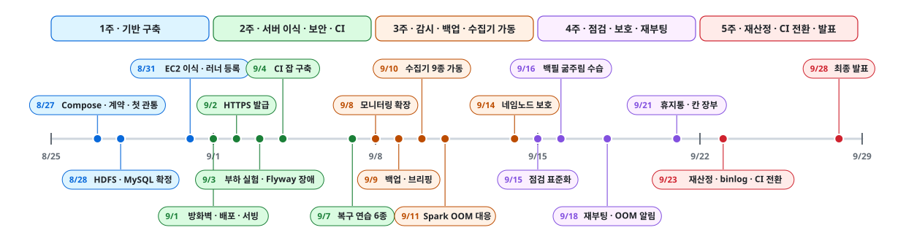
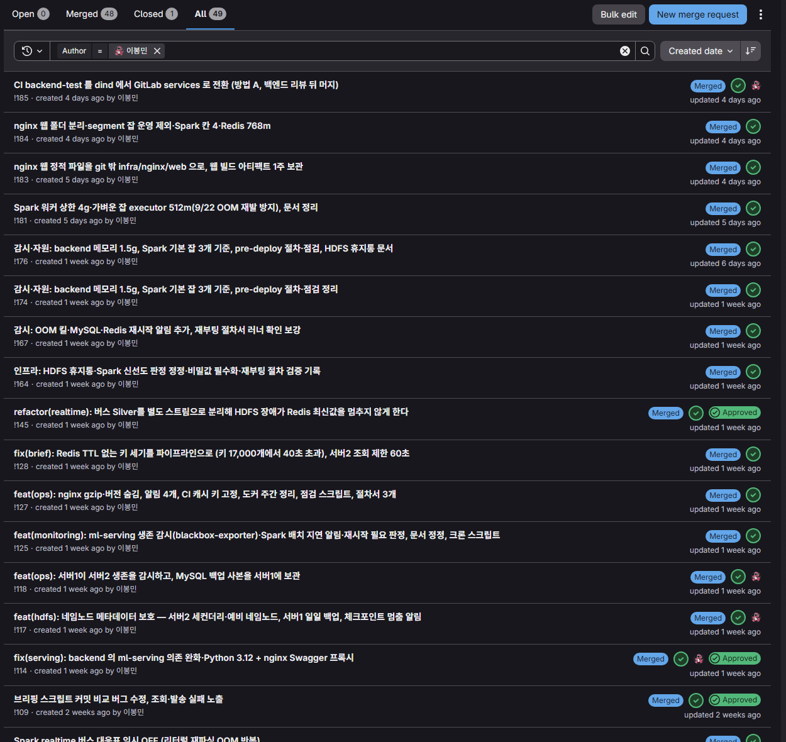
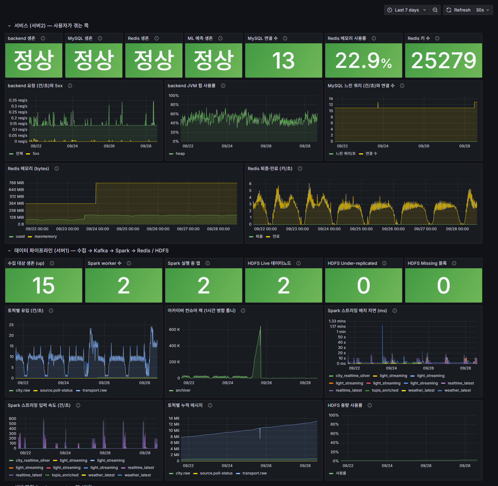
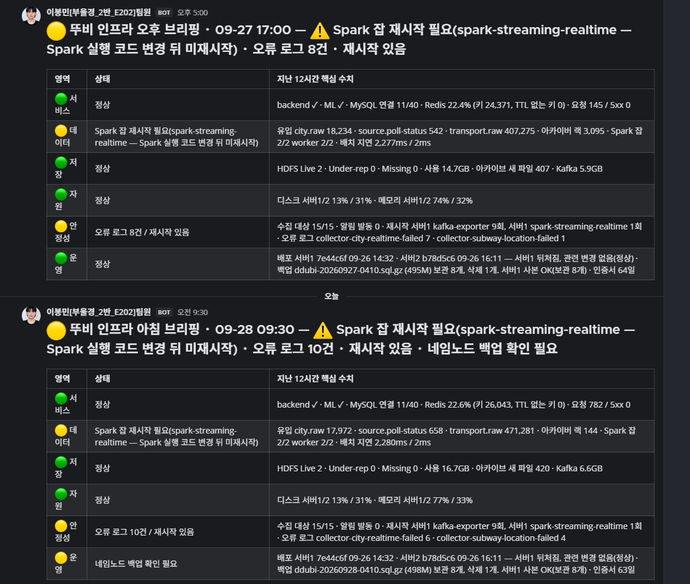
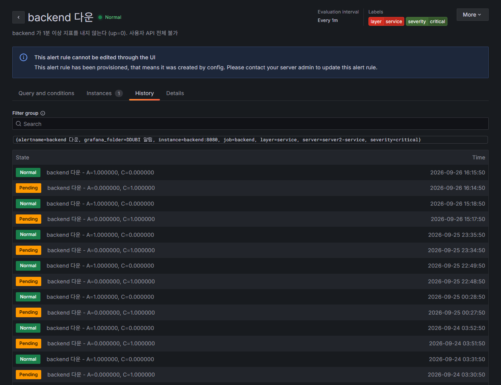
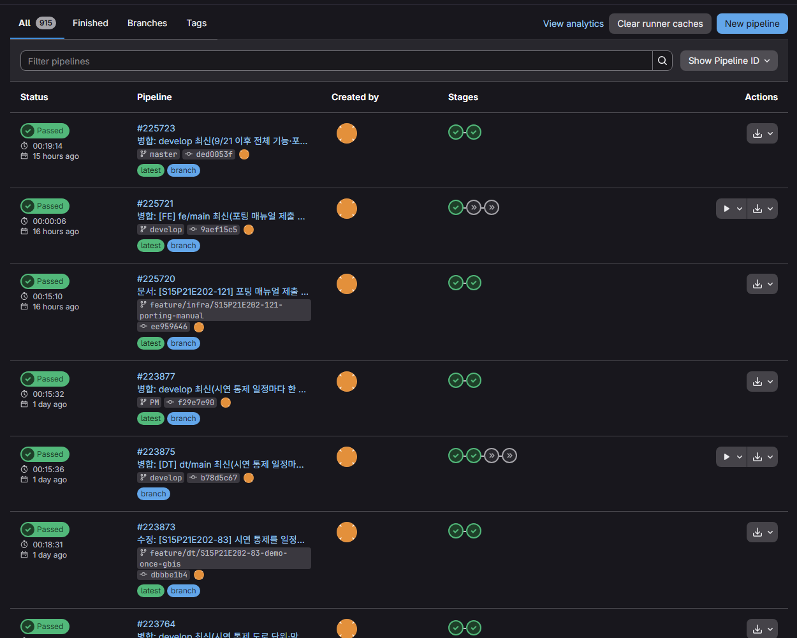
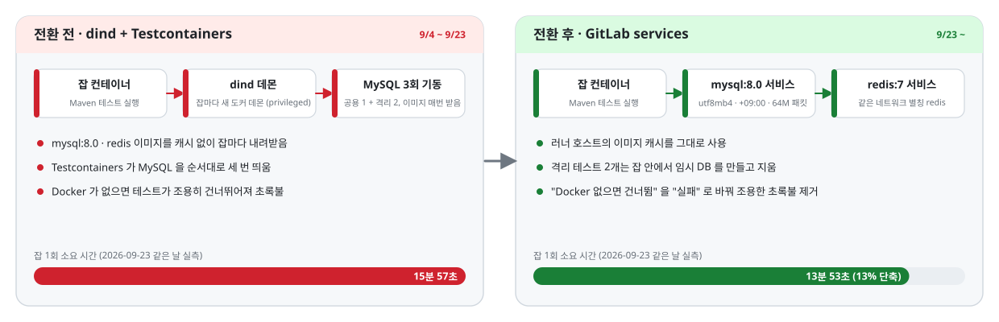

<div align="center">


<p><b>실시간 교통 데이터 파이프라인과 서버 2대 운영 기록</b><br/>
일정을 등록하면 실시간 교통·날씨·행사 데이터를 분석해 <b>몇 시에 출발해야 하는지</b>를 알려 주고,<br/>
상황이 바뀌면 출발 시각을 다시 계산해 알려 주는 서비스입니다.</p>

<p>


<br/>


</p>

<p>
<a href="#3-아키텍처와-설계-결정">아키텍처</a> ·
<a href="#5-담당-업무-상세">담당 업무</a> ·
<a href="#6-장애와-트러블슈팅">트러블슈팅</a> ·
<a href="#8-협업">협업</a> ·
<a href="../docs/runbooks/README.md">장애 절차서 10개</a> ·
<a href="../docs/experiments/2026-09-07-recovery-drill.md">복구 연습 기록</a> ·
<a href="../docs/data-retention.md">보존 정책</a> ·
<a href="../exec/1_포팅_매뉴얼.md">포팅 매뉴얼</a>
</p>

</div>

> [!NOTE]
> 이 문서는 팀 프로젝트 저장소를 **인프라 담당(이봉민)** 의 관점에서 설명하는 README 입니다. 6명 팀에서 데이터 파이프라인 기반, 서버 2대 운영, CI/CD, 모니터링·알림, 장애 복구·보존, 자원 산정을 혼자 맡았습니다. 한 달 동안 겪은 장애·사고 25건을 증상·원인·조치·재발 방지로 기록하고, 복구 절차 6개를 실제 운영 서버에서 검증했습니다. 팀 공용 README 는 [README.md](../README.md)에 그대로 있습니다.

<p align="center">
  <picture>
    <source media="(prefers-color-scheme: dark)" srcset="assets/stats-dark.svg">
    
  </picture>
</p>

<p align="center">
  <picture>
    <source media="(prefers-color-scheme: dark)" srcset="assets/architecture-dark.svg">
    
  </picture>
  <br/><sub>서버1(데이터)과 서버2(서비스)의 배치. 색은 흐름의 종류(데이터 · 사용자 요청 · HDFS 복제 · 지표와 알림 · CI 배포)이고, 그림 아래에 범례가 있습니다. 화면 테마에 맞춰 밝은 판과 어두운 판이 자동으로 바뀝니다.</sub>
</p>

---

<p align="center"><sub>
<a href="#1-프로젝트-소개">1. 프로젝트 소개</a> · <a href="#2-내가-맡은-것">2. 내가 맡은 것</a> · <a href="#3-아키텍처와-설계-결정">3. 아키텍처와 설계 결정</a> · <a href="#4-숫자로-보는-운영-결과">4. 숫자로 보는 운영 결과</a> · <a href="#5-담당-업무-상세">5. 담당 업무 상세</a> · <a href="#6-장애와-트러블슈팅">6. 장애와 트러블슈팅</a><br/>
<a href="#7-감시-설계-원칙">7. 감시 설계 원칙</a> · <a href="#8-협업">8. 협업</a> · <a href="#9-학습-기록">9. 학습 기록</a> · <a href="#10-저장소-안내">10. 저장소 안내</a> · <a href="#11-실행과-확인">11. 실행과 확인</a> · <a href="#12-회고와-한계">12. 회고와 한계</a>
</sub></p>

---

## 1. 프로젝트 소개

| 항목 | 내용 |
|---|---|
| 기간 | 2026-08-25 \~ 2026-09-29 (SSAFY 특화 프로젝트, 최종 발표 9/28) |
| 팀 | 6명 (PM 1, 백엔드·데이터 3, 프론트 1, 인프라 1) |
| 서비스 | 일정 등록, 교통 변수 분석, 출발 시각·경로 추천, 상황 변화 알림을 앱(Android·Web) 하나에서 제공 |
| 데이터 | 공공 API 9종 (서울 버스 도착·위치, 지하철 도착·위치·알림, 도시데이터, 교통 돌발, 교통 공지, 기상청 실황) |
| 운영 환경 | Ubuntu 24.04 EC2 2대 (각 4코어·16GB), Docker Compose 서비스 45개·프로필 17개 |

길찾기 앱은 길을 알려 주지만, 오늘 생긴 사고·도로 통제·지하철 지연·비 같은 변수까지 먼저 알려 주지는 않습니다. 뚜비는 사용자가 일정을 등록하면 이동 순서대로(도보·버스·지하철) 소요 시간을 계산해 출발 시각을 추천하고, 교통 상황이 바뀌어 정시 도착이 어려워지면 더 이른 출발 시각을 다시 제안해 알림을 보냅니다. 변동이 큰 버스 구간 시간은 약 1억 행의 과거 운행 데이터로 학습한 모델(LightGBM)이 구간별로 예측합니다.

<p align="center">
  
  <br/><sub>서비스가 하는 일. 예상 소요 시간이 35분에서 43분으로 늘어나자 08:22 출발을 다시 추천하고 알림을 보냅니다. (최종 발표 자료의 개념 그림이며 실제 앱 화면은 아닙니다)</sub>
</p>

<p align="center">
  
  <br/><sub>사용자가 거치는 4단계: 일정 등록, 출발 시각 추천, 상세 경로, 상황 변화 알림. (발표 자료의 개념 그림)</sub>
</p>

이 서비스가 돌아가려면 공공 데이터가 끊임없이 들어와야 합니다. 수집기 9개가 공공 API 를 주기적으로 호출하고, 하루 약 70만\~90만 건의 원본 이벤트가 Kafka 를 거쳐 Spark 로 처리되어 Redis 최신값과 HDFS 보관본으로 갈라집니다. 이 데이터 기반과 서버 2대의 운영 체계를 처음부터 끝까지 혼자 맡았습니다.

<p align="center">
  <picture>
    <source media="(prefers-color-scheme: dark)" srcset="assets/timeline-dark.svg">
    
  </picture>
  <br/><sub>5주 동안의 인프라 작업 흐름. 첫 주에 기반을 만들고, 이후 4주는 운영하면서 감시·절차·자원 장부를 되먹임했습니다.</sub>
</p>

### 기술 스택

| 영역 | 기술 | 비고 |
|---|---|---|
| 메시지·스트리밍 | Apache Kafka 3.9 (KRaft), Spark Structured Streaming 3.5 (PySpark) | 파티션 3, 보존 21일, 체크포인트는 HDFS |
| 저장 | HDFS 3.4 (복제 2, 두 서버에 데이터노드), Parquet, Redis 7, MySQL 8 | 원본은 영구 보관, 실시간 값은 TTL 로 만료 |
| 수집·적재 | Python 3.11 수집기 9개, Kafka 에서 Parquet 으로 옮기는 아카이버 | 첫 뼈대와 공통 모듈을 만들고, 소스별 로직은 데이터 담당이 확장 |
| 서빙 | nginx 1.27 (certbot 자동 갱신 설정, 첫 갱신은 미검증), Spring Boot backend, ml-serving | backend·ML 코드는 다른 팀원 몫, 컨테이너·프록시·배포는 인프라 몫 |
| 운영 | Docker Compose (서비스 45·프로필 17), Ubuntu 24.04 EC2 2대 | 전 컨테이너 메모리 상한·로그 회전 |
| CI/CD | GitLab CI 잡 18개, GitLab Runner 17.11 (docker executor, 직접 등록), SSH 배포 | 공용 러너·레지스트리 없는 환경 |
| 모니터링 | Prometheus 2.55, Grafana 11.3, exporter 6종(blackbox 포함), Mattermost 웹훅 | 알림 규칙 20개(저장소 기준), 자동 브리핑 하루 2회 |
| 보안 | iptables DOCKER-USER 체인, 키 인증 SSH, Let's Encrypt, 비밀값은 .env(600)·CI 변수 | 외부 공개 포트는 80/443 만. 보안 그룹은 계정 정책상 열려 있어 서버 안 방화벽이 유일한 겹 |

## 2. 내가 맡은 것

| 영역 | 한 일 | 산출물 |
|---|---|---|
| **파이프라인 구축** | 수집기, Kafka, Spark, Redis, HDFS 를 잇는 compose 스택을 만들고, 데이터 계약(토픽·Redis 키·이벤트 스키마)을 코드보다 먼저 작성 | [docker-compose.yml](../infra/docker-compose.yml) · [topics.yaml](../docs/contracts/topics.yaml) · [redis-keys.yaml](../docs/contracts/redis-keys.yaml) · [events/](../docs/contracts/events) |
| **서버 이식·네트워크·보안** | 로컬 스택을 EC2 2대에 이식, 도커가 ufw 를 우회하는 문제를 DOCKER-USER 체인으로 해결, HTTPS 발급과 갱신 설정, 비밀값 경로 확정 | [firewall.sh](../infra/scripts/firewall.sh) · [nginx 템플릿](../infra/nginx/templates/default.conf.template) · [server1](../infra/docker-compose.server1.yml)·[server2](../infra/docker-compose.server2.yml) 오버레이 |
| **CI/CD** | 러너 등록, 검증·빌드·배포 잡 설계, 배포 전후 점검 스크립트, backend 테스트 잡을 dind 에서 services 로 전환 | [.gitlab-ci.yml](../.gitlab-ci.yml) · [post-deploy.sh](../infra/scripts/post-deploy.sh) · [backend-ci-requirements.md](../docs/contracts/backend-ci-requirements.md) |
| **모니터링·알림·브리핑** | Prometheus 대상 15개, Grafana 대시보드 28패널·알림 규칙 20개, 하루 2회 자동 브리핑, 읽기 전용 점검 스크립트 113항목 | [prometheus.yml](../infra/monitoring/prometheus/prometheus.yml) · [rules.yaml](../infra/monitoring/grafana/alerting/rules.yaml) · [daily-brief.py](../infra/scripts/daily-brief.py) · [checks/](../infra/scripts/checks) |
| **복구·보존** | 절차서 10개를 쓰고 6개 시나리오를 실제 서버에서 검증, 데이터 10종의 보존 기간 수치화, MySQL·네임노드 일일 백업과 서버 간 사본, 네임노드 이어받기 스크립트 | [runbooks/](../docs/runbooks/README.md) · [data-retention.md](../docs/data-retention.md) · [backup-db.sh](../infra/scripts/backup-db.sh) · [failover-namenode.sh](../infra/scripts/failover-namenode.sh) |
| **자원 산정·실험** | Spark 워커 칸·executor 메모리 장부, Redis 용량 최악치, Kafka 보존 상한을 실측으로 정하고 부하 실험으로 검증 | [부하 실험](../docs/experiments/2026-09-03-load-test-round1.md) · [실험 절차서](../docs/experiments/load-test-runbook.md) · [.env.example](../infra/.env.example) |

> [!IMPORTANT]
> **역할의 경계.** Spark 스트리밍 잡의 도메인 로직(버스·지하철 정규화, Feature 계산), backend API, ML 모델, Flutter 앱은 다른 팀원이 만들었습니다. 저는 그 코드가 올라가는 자리(컨테이너·자원·배포·감시)와 데이터가 흐르는 길(Kafka·HDFS·Redis 계약)을 만들고 운영했습니다. 날씨 스트리밍 잡과 Spark 공통 모듈([kafka_source](../sparkjobs/common/kafka_source.py), [redis_sink](../sparkjobs/common/redis_sink.py), [archive_source](../sparkjobs/common/archive_source.py)), 수집기·아카이버의 첫 버전([publisher.py](../collector/src/publisher.py), [storage.py](../archiver/src/storage.py), [replay.py](../archiver/src/replay.py))은 직접 썼습니다.

<details>
<summary><b>GitLab 에 올린 MR 49개 목록 화면 보기</b> (병합 48 · 닫힘 1)</summary>
<br/>
<p align="center"></p>
</details>

## 3. 아키텍처와 설계 결정

서버1은 데이터를 받아 처리하고, 서버2는 사용자 요청을 받습니다. 두 서버는 사설망으로만 서로를 열어 두고, 외부에는 서버2의 80/443 만 공개합니다. 계산은 서버1 안에서 파티션 3개와 워커 2대로 나누고, 저장은 HDFS 복제 2로 두 서버에 물리적으로 나눕니다. 그림은 이 문서 맨 위에 있고, 자세한 배치는 [docs/architecture.md](../docs/architecture.md)와 [infra/README.md](../infra/README.md)에 있습니다.

| 구간 | 흐름 |
|---|---|
| 수집 | 수집기 9개가 키별 하루 호출 예산 안에서 공공 API 를 부르고, 계약된 스키마로 Kafka 원본 토픽(`transport.raw`, `city.raw`)과 수집 상태 토픽(`source.poll-status`)에 발행 |
| 실시간 | Spark Structured Streaming 이 Kafka 를 구독해 최신값을 Redis 에 쓰고(모든 키에 TTL), 체크포인트는 HDFS 에 둠 |
| 보관 | 아카이버가 Kafka 를 1시간 단위 Parquet 으로 병합해 HDFS 에 적재 (복제 2, 두 서버) |
| 서빙 | nginx(443)가 유일한 진입점. backend 가 Redis 최신값과 MySQL 을 읽고, 버스 구간 시간은 ml-serving 에 물음 |
| 감시 | exporter 6종(blackbox 포함)과 앱 지표로 Prometheus 가 15개 대상을 긁고, Grafana 규칙 20개와 자동 브리핑이 Mattermost 로 감 |

### 핵심 설계 결정, 버린 대안, 치른 비용

| 결정 | 이유 | 버린 대안 | 치른 비용과 남은 한계 |
|---|---|---|---|
| Kafka 를 가운데 둔다 | 수집 속도와 소비 속도가 다르고, 소비자가 죽어도 원본이 21일 남아 재처리할 수 있다 | 수집기가 DB 에 직접 쓰기 (소비자 추가와 재처리가 불가능) | 브로커가 1대라 Kafka 자체가 죽으면 그 동안의 수집은 유실된다. 9/3 재부팅 때 14건이 그렇게 사라졌고, 수집기 쪽 대기와 재전송으로 보완했다 |
| 보존 21일 + 파티션당 상한 (1GiB, transport 는 4GiB) | 시간과 크기 중 먼저 걸리는 쪽이 지운다. 실시간 수집 계획 기준 하루 약 200MB 면 토픽 3GiB(파티션당 1GiB)가 15일에 차서 21일보다 먼저 걸리므로 transport 토픽을 4GiB 로 올렸다 | 무제한 보존 | 상한을 넘으면 21일보다 먼저 지워진다. 유입이 계획보다 늘면 다시 재야 하므로 하루 유입을 브리핑에 넣었다 |
| HDFS 복제 2, 데이터노드를 두 서버에 | 추가 비용 없이 물리적으로 나뉜 보관 | S3 (배우려는 것이 복제와 장애 처리였다) | 디스크를 두 배 쓰고(7.0GB 가 14.1GB), 네임노드 메타데이터는 한 곳에만 있다. 서버 2대로는 고가용성 구성이 안 돼 세컨더리·일일 백업·이어받기 절차로 대신했고, 이어받기는 격리 시험만 했다 |
| Redis 는 volatile-ttl, TTL 은 수집 주기의 3배 | 실시간 값은 전부 만료가 있어야 상한에서 오래된 것부터 지워지고, 오래 사는 대응표가 밀리지 않는다 | allkeys-lru | TTL 없는 키는 영원히 남으므로 그런 키는 계약 문서에 사유를 적게 했다. 주기를 바꾸면 TTL 도 같이 바꿔야 하고, 9/10 에 그 불일치로 키 대부분이 비어 있었다 |
| 파이프라인은 MySQL 을 직접 쓰지 않는다 | 스키마 소유권이 둘로 갈리면 마이그레이션 사고가 난다. 적재는 Spring 내부 API 를 거친다 | Spark JDBC 직접 쓰기 | 업로드 API 와 클라이언트를 만들어 통합 시험까지 통과했지만, 기준선을 외부 경로 API 값으로 쓰기로 결정이 바뀌어 지금은 쓰이지 않는다 |
| nginx 가 backend 주소를 10초마다 다시 조회 | 배포로 컨테이너 IP 가 바뀌어도 502 가 최대 10초 안에 스스로 풀린다 | 배포마다 수동 reload | backend 재빌드 배포 자체의 끊김(약 20분)은 못 줄인다. 이미지를 미리 만들어 두는 방식은 레지스트리가 없어 보류했다 |
| Docker Compose | 서버 2대·4코어에서는 오케스트레이션 비용이 이득보다 크다 | Kubernetes | 자동 복구가 컨테이너 재시작 정책 수준이다. `docker kill` 로 죽인 컨테이너는 안 살아나고(9/7 연습), 자원 재배분은 사람이 장부를 들고 한다 |
| 설정 파일은 디렉터리 단위로 마운트 | 단일 파일 마운트는 git pull 로 파일이 교체되면 컨테이너에 반영되지 않는다 (9/3 발견) | 단일 파일 마운트 | HDFS xml 은 아직 단일 파일이라 바꾸면 컨테이너를 재생성해야 하고, 그때 세이프모드 30초\~1분이 생긴다 |

## 4. 숫자로 보는 운영 결과

### 전후 비교

| 항목 | 전 | 후 | 무엇으로 확인했나 |
|---|---|---|---|
| backend 장애 인지 | 70분 뒤 사람이 발견 (9/3) | 5분 안에 자동 알림 (9/17 배포 끊김 때 관측) | Grafana 알림 이력, Mattermost 메시지 |
| 데이터노드 사망 판정 | 10분 30초 (기본값) | 1분 30초 | 설정값. 9/7 연습에서 약점을 찾고 9/9 에 적용 |
| 재부팅 뒤 수집 유실 | 14건 (9/3) | 0건 (9/18 두 서버 재부팅) | Kafka 오프셋과 수집기 로그 |
| Spark 드라이버 재시작 | 5시간 30분 동안 60회 (9/11) | 0회 (flag 로 끈 뒤 30분 관찰, 이후 재발 없음) | 컨테이너 재시작 수 |
| backend 테스트 잡 | 15분 57초 | 13분 53초 | 같은 날 같은 부하에서 2회씩 측정 |
| 브리핑의 Redis 조회 | 40초 초과로 실패 | 2초 | 키 17,000개 기준 측정 |
| 서버2 디스크 | 50% | 39% | binlog 보존 30일에서 1일로 |

### 운영 규모 (2026-09-28)

값의 종류를 구분했습니다. "관측" 은 그날 서버에서 읽은 값, "설정" 은 저장소 파일에 적힌 값, "검증" 은 연습이나 실험으로 잰 값입니다.

| 구분 | 값 | 종류 |
|---|---|---|
| **누적 원본 유입** | 약 1,380만 건 (Kafka 오프셋 기준), 하루 약 70만\~90만 건 | 관측 |
| **저장 규모** | Kafka 6.6GB · HDFS 아카이브 7.0GB (복제 후 14.1GB, Parquet 4,602개) · Redis 176MB/768MB (키 25,486) · MySQL 약 14GB | 관측 |
| **감시** | Prometheus 대상 15 · Grafana 패널 28 · 알림 규칙 20 (저장소 기준, 서버에는 21) · 자동 브리핑 하루 2회 · 점검 항목 113 | 설정 |
| **안정성** | 복구 연습 6개 시나리오 모두 유실 0 (통과 4 · 부분 통과 2) · 배포 롤백 2분 59초 · 두 서버 재부팅 합계 10분 (API 끊김 2분) | 검증 |
| **알림** | 9/8\~9/26 실제 발동 18건 (backend 다운 4, OOM 3, 호스트 메모리 4, 아카이버 2, 기타 5) | 관측 |
| **CI/CD** | 잡 18개 · 러너 하루 약 380잡 | 설정 · 관측 |
| **문서** | 절차서 10개 (검증 8 · 격리 시험 1 · 미검증 1 로 표기) · 실험 기록 3 · 데이터 계약 · 보존 정책 | 설정 |

<table>
  <tr>
    <td width="50%" align="center">
      <br/>
      <sub><b>Grafana 대시보드</b> · 서비스 / 데이터 파이프라인 / 서버 자원 3행, 최근 7일 (9/28 실제 화면)</sub>
    </td>
    <td width="50%" align="center">
      <br/>
      <sub><b>자동 브리핑</b> · 팀 채널에 09:30·17:00 발송, 6영역 상태표 (9/27 과 9/28 실제 메시지)</sub>
    </td>
  </tr>
  <tr>
    <td width="50%" align="center">
      <br/>
      <sub><b>알림 규칙 상태 이력</b> · 배포 때마다 Pending 으로 갔다가 1분 안에 Normal 로 복귀</sub>
    </td>
    <td width="50%" align="center">
      <br/>
      <sub><b>CI 파이프라인</b> · 누적 915개, 검증 잡과 사람이 누르는 배포 버튼</sub>
    </td>
  </tr>
</table>

## 5. 담당 업무 상세

업무마다 문제, 한 일, 결과를 세 줄로 적었습니다. 깊은 내용은 각 줄의 링크(절차서·실험·학습 기록)에 있습니다.

<details open>
<summary><b>5-1. 데이터 파이프라인 기반 구축</b> · 8/27 ~ 9/2 · 계약 파일을 먼저 쓰고 첫 주에 Kafka 부터 HDFS 까지 관통</summary>

- **문제**: 팀원 5명이 각자 코드를 쓰기 전에 데이터가 어디로 어떤 모양으로 흐를지가 먼저 정해져야 했습니다.
- **한 일**: Kafka 토픽·Redis 키·이벤트 JSON Schema 계약을 먼저 쓰고, 그 계약대로 수집기·Kafka·Spark·아카이버·HDFS 를 compose 프로필로 이어 기상청 실데이터를 Redis 와 HDFS 까지 관통시켰습니다. 아카이브를 Kafka 로 배속 재생하는 도구도 만들었습니다. 저장 계층은 "원본은 영구, 나머지는 재생산 가능한 캐시" 로 나눴습니다.
- **결과**: 8/28 첫 관통 이후 구조 변경 없이 수집기 9개와 스트리밍 잡 여러 개로 확장됐고, 9/2 재생 도구로 4,057건을 초당 500건씩 10초에 무손실로 다시 흘려 보냈습니다. ([8/27 학습 기록](til/2026-08-27-infra.md), [8/28](til/2026-08-28-infra.md))

</details>

<details>
<summary><b>5-2. 서버 이식·네트워크·보안</b> · 8/31 ~ 9/2, 이후 보강 · 도커의 ufw 우회를 DOCKER-USER 체인으로 막고 80/443 만 공개</summary>

- **문제**: 로컬 한 대에서 돌던 스택을 EC2 2대로 옮겨야 했고, 보안 기본선을 스스로 정해야 했습니다. 도커는 ufw 규칙을 우회하고, EC2 는 공인 IP 를 사설 IP 로 1:1 변환해 넣어 바인딩 주소로는 인터넷과 이웃 서버를 가를 수 없었습니다.
- **한 일**: 서버별 오버레이 compose 두 장으로 역할을 나눠 이식하고, iptables DOCKER-USER 체인에 "상대 서버 허용, 응답 허용, 80/443 만 공개, 나머지 차단" 을 스크립트로 고정했습니다. Let's Encrypt 인증서를 발급해 certbot 갱신을 설정했고, 비밀값은 서버 .env(600)와 CI 변수 두 경로로만 다루는 팀 규칙을 정했습니다. 보안 그룹이 1024 이상을 전부 열어 둔 상태임을 실측해 서버 안 방화벽이 유일한 겹임을 팀에 알렸습니다. HSTS 는 인증서 사고 때 우회가 불가능해 넣지 않았습니다.
- **결과**: 외부에서 관리 포트가 모두 막히고 443 만 열린 것을 실측했고, SSH 봇 시도 수천 건이 전부 인증 전 단계에서 끊겼습니다. 첫 인증서 자동 갱신은 프로젝트 기간 뒤라 미검증입니다. ([9/1](til/2026-09-01-infra.md), [9/18](til/2026-09-18-infra.md))

</details>

<details>
<summary><b>5-3. CI/CD</b> · 8/31 ~ 9/23 · 러너 직접 등록, 잡 18개, 배포 뒤 생존 확인, backend 테스트 잡을 dind 에서 services 로 전환</summary>

- **문제**: 팀 GitLab 에 공용 러너와 컨테이너 레지스트리가 없었고, 가장 긴 backend 테스트 잡이 러너 슬롯 시간의 절반 이상을 차지했습니다.
- **한 일**: 서버2에 러너를 등록하고 검증·빌드·배포 잡을 설계했습니다. 배포 잡 끝에 nginx 재적용, Prometheus 재적재, 컨테이너 생존, API 응답 확인을 붙여 "배포가 끝났다" 와 "서비스가 살아 있다" 를 같은 잡에서 판정하게 했습니다. 파이프라인이 도는 자리를 세 곳으로 줄이고 배포 잡을 직렬화했습니다. 9/23 에는 러너 24시간 기록으로 시간이 어디에 쓰이는지 센 뒤 backend 테스트 잡을 GitLab services 방식으로 바꾸고, "Docker 가 없으면 건너뜀" 을 실패로 바꿨습니다.
- **결과**: 잡 하나는 15분 57초에서 13분 53초로 줄었지만, 한 번의 푸시가 브랜치와 MR 두 벌의 파이프라인을 만들고 한 줄로 기다리는 구조라 체감은 그대로였습니다. 남은 병목을 규칙(두 벌 차단), 백엔드(Spring 컨텍스트 14개), 인프라(잔잡 통합)로 소유자별로 나눠 기록했습니다. ([9/4](til/2026-09-04-infra.md), [9/23](til/2026-09-23-infra.md))

<p align="center">
  <picture>
    <source media="(prefers-color-scheme: dark)" srcset="assets/ci-services-dark.svg">
    
  </picture>
</p>

</details>

<details>
<summary><b>5-4. 모니터링·알림·자동 브리핑</b> · 9/1 ~ 9/18 · 70분 무감지 장애 뒤 대상 15개·규칙 20개·하루 2회 브리핑으로</summary>

- **문제**: 9/3 backend 가 70분 동안 죽어 있었는데 아무도 몰랐습니다. nginx 의 healthz 는 nginx 자신의 응답이었고, Prometheus 는 backend 를 보지 않았습니다.
- **한 일**: Prometheus 대상을 backend actuator, Spark, HDFS, Redis, MySQL, 공개 HTTPS 까지 15개로 늘리고, Grafana 를 3행 28패널로 재구성했습니다. 알림 규칙 20개를 파일로 프로비저닝해 Mattermost 로 보내고(제목에 판정 근거와 대체 동작을 적음, 배포 끝에 재적재 API 호출), 아침·오후 6영역 상태표를 보내는 브리핑과 읽기 전용 점검 스크립트 113항목을 만들었습니다. 브리핑은 조회에 실패하면 빨간불을 내고 스스로 죽으면 별도 통보를 보내며, 실패 경로 시험 16개를 통과해야 배포합니다.
- **결과**: 9/17 다른 팀 배포로 API 가 20분 끊겼을 때 5분 안에 빨간불과 회복 뒤 초록불이 갔고, 9/22 17:34 Spark 워커 메모리 초과를 새 규칙이 1분 안에 알렸습니다. ([9/8](til/2026-09-08-infra.md), [9/15](til/2026-09-15-infra.md))

</details>

<details>
<summary><b>5-5. 장애 복구 절차와 데이터 보존</b> · 9/7 ~ 9/21 · 절차서 10개, 실제 서버에서 6개 시나리오 검증, 데이터 10종 보존 정책</summary>

- **문제**: 데이터가 쌓이기 시작하면서 "죽으면 어떻게 살리나" 와 "무엇을 언제까지 두나" 에 답이 필요했습니다.
- **한 일**: 절차서 6종을 먼저 쓰고 운영 서버에서 장애를 일으켜 전부 따라 해 봤습니다. 이후 재부팅, 인증서 갱신, 모델 묶음 교체, 네임노드 메타데이터 손실까지 10개로 늘리고 검증 여부를 "검증됨 / 격리 시험 / 미검증" 으로 표기했습니다. MySQL 은 서버2에서 매일 덤프해 서버1에 사본을 두고, 네임노드 메타데이터는 서버2 세컨더리 체크포인트와 서버1 일일 백업 두 곳에 남기며, HDFS 휴지통(24시간)을 켰습니다. 데이터 10종의 보존 기간과 지우는 주체를 표로 고정했습니다.
- **결과**: 6개 시나리오 모두 유실 0(통과 4, 부분 통과 2). 부분 통과 둘은 `docker kill` 로 죽인 Spark 컨테이너는 재시작 정책이 안 살린다는 점과, 데이터노드가 죽은 직후 최대 10분 30초 동안 읽기가 실패한다는 점이었고, 뒤쪽은 사망 판정을 1분 30초로 줄여 고쳤습니다. 네임노드 이어받기는 격리 시험에서 35\~47초, 결함 4개 반영. 재부팅은 두 서버 합계 10분, 유실 0. ([복구 연습 기록](../docs/experiments/2026-09-07-recovery-drill.md), [보존 정책](../docs/data-retention.md))

| 시나리오 (2026-09-07 실제 서버) | 결과 |
|---|---|
| Spark 스트리밍 잡 사망 | 컨테이너 kill 은 수동 재시작 37초(부분 통과) / 드라이버 kill 은 자동 17초, 유실 0 |
| backend 사망, 재생성 뒤 nginx 502 | 자동 복구 21초 / reload 1초 |
| HDFS 데이터노드 정지 83초 | 복귀 5초, 쓰기 정상, 죽은 직후 읽기 실패(부분 통과). 사망 판정 10분 30초를 1분 30초로 단축 |
| Kafka 재시작 | 16초, 오프셋 보존 |
| 아카이브 재처리 | 배치 재실행 55초(2,142행) · 원본 2,000건 재생 37초, 무손실 |
| 배포 롤백 (revert 재배포) | 2분 59초 |
| 서버 재부팅 (9/18 추가) | 두 서버 합계 10분, API 끊김 2분 |
| 네임노드 이어받기 (9/14 격리 시험) | 35\~47초, 결함 4개 반영 |

</details>

<details>
<summary><b>5-6. 자원 산정과 성능 실험</b> · 9/3 ~ 9/23 · 부하 실험 "차이 없음" 을 그대로 기록, 워커 OOM 뒤 메모리 장부 공식</summary>

- **문제**: 4코어·16GB 서버 2대에 Kafka·Spark·HDFS·Redis·MySQL·backend 를 전부 올려야 했고, 새 잡이 하나 늘 때마다 어딘가가 메모리 초과로 죽었습니다.
- **한 일**: 9/3 부하 실험으로 worker 1대와 2대를 비교했고(66,000건을 약 4,000건/초로 투입, 총 26만 건 재생, 모든 회차를 체크포인트 오프셋과 대조), 결론 "차이 없음" 을 그대로 적었습니다. 배치 시간의 대부분이 건수와 무관한 고정비였기 때문입니다. 9/22 워커 메모리 초과 뒤에는 executor 실제 메모리를 재서(힙 768MB 설정에 고정비 약 200MB, 많을 때 1,373MB) "칸 수 × (힙 + 400m) + 340m" 장부 공식을 만들어 워커 4g·경량 잡 512m·칸 4로 재배분했습니다. Redis 는 최악치 계산으로 768MB 로, MySQL binlog 는 보존 1일로 바꿨습니다. 자원 판단마다 "무엇이 추가되면 깨지는가" 를 함께 적었습니다.
- **결과**: worker 1대 10초·9,200건/초, 2대 11초·10,250건/초. 재배분 뒤에도 9/25 executor 가 두 번 더 상한에 걸렸고, 같은 날 PM 이 가벼운 잡 4개를 한 앱으로 합친 뒤 9/28 까지 재발하지 않았습니다. 디스크는 50%에서 39%로. ([부하 실험](../docs/experiments/2026-09-03-load-test-round1.md), [9/23 학습 기록](til/2026-09-23-infra.md))

</details>

### 코드로 보는 설계 세 곳

본인이 쓴 코드 중 설계 의도가 짧게 드러나는 부분입니다. 전체는 링크에 있습니다.

**방화벽은 ufw 가 아니라 DOCKER-USER 체인에 둡니다.** 도커는 공개 포트의 iptables 규칙을 직접 관리해 ufw 를 우회하므로, 도커가 사용자 규칙 자리로 보장하는 체인에 넣어야 컨테이너 트래픽이 실제로 걸러집니다. ([firewall.sh](../infra/scripts/firewall.sh))

```bash
iptables -N DOCKER-USER 2>/dev/null || true
iptables -F DOCKER-USER
# 1) 상대 서버에서 오는 트래픽 허용 (Spark->Redis, HDFS 복제, Prometheus 스크랩 등)
iptables -A DOCKER-USER -i "$IFACE" -s "$PEER" -j RETURN
# 2) 컨테이너가 먼저 나간 연결의 응답 허용 (수집기의 외부 API 응답 등)
iptables -A DOCKER-USER -i "$IFACE" -m conntrack --ctstate RELATED,ESTABLISHED -j RETURN
# 3) 웹 공개 (서비스 서버에서 nginx 도입 후 --web 로 켠다)
if [ "$WEB" = "--web" ]; then
  iptables -A DOCKER-USER -i "$IFACE" -p tcp -m multiport --dports 80,443 -j RETURN
fi
# 4) 그 외 외부에서 컨테이너로 오는 모든 신규 연결 차단
iptables -A DOCKER-USER -i "$IFACE" -j DROP
```

**재시도는 "어떤 예외인지" 를 알고 넣습니다.** HDFS 라이브러리는 세이프모드를 일반 RuntimeError 로 던집니다. RuntimeError 전부를 재시도하면 진짜 버그도 삼키므로, 메시지에 표식이 있을 때만 재시도합니다. 9/9 배포 때 아카이버가 33초 동안 9번 죽은 뒤 넣은 코드입니다. ([archiver/src/storage.py](../archiver/src/storage.py))

```python
_RETRIABLE = (OSError, requests.exceptions.RequestException)
_NO_RETRY_STATUS = {400, 401, 404}  # 요청 자체가 잘못된 것 — 다시 보내도 같다
_RETRIABLE_RUNTIME_MARKERS = ("safe mode", "safemode", "retriable", "standby")

def _is_retriable(exc: BaseException) -> bool:
    if isinstance(exc, _RETRIABLE):
        status = _response_status(exc)
        return status not in _NO_RETRY_STATUS
    if isinstance(exc, RuntimeError):
        msg = str(exc).lower()
        return any(m in msg for m in _RETRIABLE_RUNTIME_MARKERS)
    return False
```

**감시 도구는 자기 실패를 숨기지 않습니다.** 브리핑이 Prometheus 나 서버 조회에 실패하면 그 항목을 비우는 대신 빨간 경고를 표에 넣습니다. 9/14 에 Prometheus 와 SSH 가 죽었는데 브리핑이 초록으로 나간 구멍을 막은 코드입니다. ([daily-brief.py](../infra/scripts/daily-brief.py))

```python
rem = collect_remote()
loc = collect_local()
# 조회 자체가 실패하면 "정상" 으로 보이면 안 된다. 실패는 🔴 경고로 표에 드러낸다
if up_total is None:
    w("안정성", "지표 조회 실패(Prometheus)")
if rem is None:
    w("안정성", "서버1 조회 실패(SSH)")
if not loc:
    w("안정성", "서버2 조회 실패(docker)")
```

## 6. 장애와 트러블슈팅

한 달 동안 기록한 장애·사고 25건 중 대표 3건은 진단 과정까지 풀어 적었고, 6건은 아래 접기 표에 요약했습니다. 나머지는 [학습 기록](til/README.md)에 날짜별로 있습니다.

### 09-03 · backend 가 70분 동안 죽어 있었는데 아무도 몰랐다

| 단계&nbsp;&nbsp;&nbsp;&nbsp;&nbsp;&nbsp;&nbsp;&nbsp;&nbsp;&nbsp; | 내용 |
|---|---|
| **증상** | 16:17 부터 사용자 API 가 전부 실패. 컨테이너는 재시작을 77회 반복. 알림은 한 건도 없었고 17:27 에 사람이 발견 |
| **진단** | 컨테이너 로그에서 Flyway(DB 마이그레이션 도구)의 체크섬 검증 실패를 확인. 이미 적용된 V1 마이그레이션 파일이 그날 배포에서 수정돼 있었음. 알림이 없던 이유는 따로 추적: nginx 의 healthz 는 nginx 자신의 응답이었고, Prometheus 는 backend 를 수집 대상에 넣지 않았음 |
| **원인** | 직접 원인은 적용된 마이그레이션 수정. 근본 원인은 감시 공백. 서비스 서버와 데이터 서버의 지표가 서로 연결돼 있지 않아 한쪽 장애가 다른 쪽에 안 보였음 |
| **조치** | 운영 DB 를 덤프해 보관한 뒤 볼륨을 재초기화해 복구. backend actuator 를 Prometheus 에 편입하고 "backend 다운" 규칙을 만들었으며, 배포 확인을 nginx 응답이 아니라 실제 API 응답(인증 필요 401)으로 바꿈. "적용된 마이그레이션은 수정하지 않고 새 번호로 추가한다" 를 팀 규칙으로 |
| **검증** | 9/17 다른 팀 배포로 API 가 20분 끊겼을 때 5분 안에 빨간불이 가고 회복 뒤 초록불이 감. 이후 backend 다운 알림이 배포마다 Pending 을 거쳐 Normal 로 돌아오는 이력이 쌓임 |

### 09-11 · Spark 드라이버가 5시간 반 동안 60번 재시작했다

| 단계&nbsp;&nbsp;&nbsp;&nbsp;&nbsp;&nbsp;&nbsp;&nbsp;&nbsp;&nbsp; | 내용 |
|---|---|
| **증상** | 버스 대응표(정류장 ID 변환표)를 연결한 배포 뒤 11:27 부터 실시간 잡이 첫 배치에서 메모리 초과로 죽고 다시 뜨기를 반복. Redis 최신값 갱신이 멈춤 |
| **진단** | 처음엔 메모리 부족으로 보고 드라이버 힙을 512m 에서 2g, 컨테이너 상한을 2560m 로 올렸지만 이번엔 커널이 컨테이너를 죽임(exit 137, 메모리 2.52GB). 힙 OOM 과 cgroup OOM 은 다른 장애라는 것을 여기서 배움. 배치가 32\~52초로 늘어난 점에서 "매 배치마다 큰 일을 다시 한다" 고 보고 코드를 읽음 |
| **원인** | 데이터 담당 코드가 21만 행 대응표를 JSON 문자열 하나로 만들어 리터럴로 조인에 넣고 캐시하지 않아, 배치마다 재파싱과 재집계가 일어남. 메모리를 아무리 올려도 해결되지 않는 구조 |
| **조치** | compose 에 "기본값 빈 문자열" 인 feature flag 를 두고 Spark 쪽 대응표만 껐음(수집기 쪽은 유지). 16:57 배포 뒤 재시작 0, 배치 12.7초, 메모리 830MiB 로 복귀. 원인 분석과 Kafka·Redis 대조 자료를 데이터 담당에게 전달해 인덱스를 캐시하도록 수정 요청 |
| **검증** | 30분 관찰로 안정 확인. 데이터 담당이 고친 뒤 9/17 에 다시 켜서 16시간 재시작 0 으로 확인. 이후 Spark 배치 시간 패널과 지연 알림을 추가 |

### 09-22 · Spark 워커가 메모리 상한에 걸리고, 한 잡은 조용히 멈췄다

| 단계&nbsp;&nbsp;&nbsp;&nbsp;&nbsp;&nbsp;&nbsp;&nbsp;&nbsp;&nbsp; | 내용 |
|---|---|
| **증상** | 17:34 서버1 워커 한 대가 메모리 상한 3g 을 넘겨 executor 하나가 죽음(exit 137). 자동 재기동으로 2분 안에 회복됐고 새 OOM 규칙이 1분 안에 알림. 다음 날 워커를 재생성하자 한 잡은 executor 를 못 받은 채 "대기" 상태로 조용히 멈춤 |
| **진단** | 워커 안 프로세스의 실제 메모리(RSS)를 재 보니 executor 가 힙 설정 768MB 보다 훨씬 큰 656\~1,373MB 였음. 힙 밖 고정비 약 200MB 에 JVM 이 쥐고 돌려주지 않는 힙이 더해진 값. 잡이 늘어 한 워커에 executor 3개가 올라가면 워커 JVM 340MB 까지 합쳐 3g 을 넘는 계산이 나옴. 멈춘 잡은 컨테이너는 Up 이라 컨테이너 감시로는 안 보였음 |
| **원인** | 자원을 "설정값" 으로만 세고 "커널이 실제로 세는 값" 으로 세지 않았음. 감시도 컨테이너 생존만 보고 Spark 마스터가 아는 실행 앱 수는 보지 않았음 |
| **조치** | 워커 상한 4g, 가벼운 잡 executor 512m, 칸 4로 재배분하고 "칸 수 × (힙 + 400m) + 340m" 장부 공식을 문서에 남김. 실행 앱 수가 기대보다 적으면 알리는 규칙을 추가하고 브리핑 판정도 앱 수 기준으로 바꿈 |
| **검증** | 재배분 뒤에도 9/25 에 executor 가 두 번 더 상한에 걸렸고, 같은 날 PM 이 가벼운 잡 4개를 한 앱으로 합친 뒤 9/28 까지 재발 없음. 완전히 내 조치만으로 끝난 것은 아니라는 점을 그대로 적음 |

<details>
<summary><b>그 밖의 사례 6건</b> (날짜순)</summary>

| 날짜 | 증상 | 원인 | 조치와 재발 방지 |
|---|---|---|---|
| **09-03** | 서버 재부팅 뒤 수집 데이터 14건 유실 | 수집기가 Kafka 보다 먼저 떠서 첫 사이클 메시지가 30초 시한을 넘겨 버려짐. "Kafka 가 유실을 막는다" 는 말은 Kafka 가 살아 있을 때만 참 | 수집기가 브로커를 최대 5분 기다리고, 메시지 시한을 10분으로, 사이클마다 flush 로 전송을 확인하도록 수정. 9/18 두 서버 재부팅에서 유실 0 으로 검증 |
| **09-09** | 배포 직후 아카이버가 33초 동안 9회 재시작 | 네임노드 재생성 뒤 세이프모드(쓰기 거부)를 HDFS 라이브러리가 일반 RuntimeError 로 던져, OSError 와 HTTP 예외만 보던 재시도 목록에 안 잡힘. 기동 시 폴더 생성도 재시도 밖 | 라이브러리 소스를 열어 실제 예외를 확인한 뒤 "safe mode · retriable · standby" 표식이 있을 때만 재시도, 기동 경로는 120초까지 대기, 배포 점검은 20초 간격 3회 재확인. 재배포 뒤 재시작 0 |
| **09-14** | PM 이 ml-serving 을 새로 배선해 배포하자 backend 가 7분 30초 멈춤 | ml-serving 컨테이너가 건강 상태에 못 들어갔는데(파이썬 3.13 이미지와 ML 라이브러리 문제), backend 가 compose `depends_on: service_healthy` 로 묶여 있어 보조 서비스 장애가 핵심 서비스로 전파됨 | 의존을 `service_started` + `required: false` 로 완화해 ml-serving 없이도 backend 가 뜨게 하고, 이미지를 3.12 로, 배포 뒤 점검에서 ml-serving 은 경고로만. "리뷰 뒤 배포, 롤백 먼저" 를 팀에 공유 |
| **09-16** | 새 버스 Silver 스트림을 켜자 서비스 스트림이 멈춤 | earliest 자동 백필이 FIFO 스케줄러에서 코어를 독점. 코어를 늘려도 독점 | 체크포인트 삭제 후 latest 로 재시작, 과거분은 다음 날 별도 배치로(9/10\~9/16 7일치를 9분에). HDFS 실패가 Redis 를 막지 않게 싱크 분리 |
| **09-17** | MySQL 이 메모리 초과로 죽었다 살아났는데 알림 없음 | 짧게 죽고 살아나 "5분 지속" 규칙에 안 걸림 | 9/18 커널 OOM 카운터와 uptime 리셋 규칙 신설. 이 규칙이 9/22 워커 OOM 을 1분 안에 알림 |
| **09-23** | 서버2 디스크 50%, MySQL binlog 54GB | ROW 포맷이 1.5MB JSON 행 갱신마다 전체를 기록하고 기본 보존이 30일 | 보존 1일로 변경, 즉시 회수해 39%. 데이터 모델 몫은 PM 에게 전달 |

</details>

관련 절차서: [backend 사망과 502](../docs/runbooks/backend-down-and-nginx-502.md) · [Spark 스트리밍 사망](../docs/runbooks/spark-streaming-crash.md) · [데이터노드 사망](../docs/runbooks/hdfs-datanode-down.md) · [네임노드 메타데이터 손실](../docs/runbooks/hdfs-namenode-metadata-loss.md) · [서버 재부팅](../docs/runbooks/server-reboot.md) · [배포 롤백](../docs/runbooks/deploy-rollback.md)

## 7. 감시 설계 원칙

> [!TIP]
> 한 달 운영에서 가장 경계한 것은 **조용한 초록불**입니다. 감시가 있는데도 장애를 모르는 상태를 없애기 위해 세 가지를 지켰습니다.

1. **감시 도구는 자기 실패를 드러내야 합니다.** 브리핑은 조회 실패를 빨간불로 표시하고, 브리핑 자체가 죽으면 별도 통보를 보냅니다. 9/15 에는 브리핑이 Redis 키 17,000개를 하나씩 묻다 40초 제한을 넘겨 스스로 빨간불을 냈고, 조회를 파이프라인으로 바꿔 2초로 줄였습니다.
2. **합계 지표에 "0 근처" 조건을 걸지 않습니다.** 아카이버 랙 합계는 토픽이 2개가 되자 영구히 참이 되어 오탐을 냈고, 대상별 "유입은 있는데 커밋이 전진하지 않음" 으로 바꿨습니다.
3. **"설정이 디스크에 있다" 와 "돌고 있는 프로세스가 그것을 읽는다" 는 다른 사실입니다.** 9/15 점검에서 Spark 잡이 나흘 전 코드로 돌아 Redis TTL 이 계약(1,080초)과 달리 119초인 것을 찾았고, 실행 코드의 마지막 변경 시각과 컨테이너 시작 시각을 비교하는 판정을 브리핑에 넣었습니다.

## 8. 협업

인프라는 혼자 맡았지만, 결정의 절반은 다른 파트와 맞추는 일이었습니다. 숫자와 비교표로 근거를 내고 상대가 결정하게 한 사례들입니다.

| 날짜 | 상황 | 내가 한 것 | 결과 |
|---|---|---|---|
| 8/31 | 기준선 데이터를 MySQL 에 어떻게 넣을지 백엔드와 의견이 갈림 | Spark 가 직접 쓰는 안과 Spring API 를 거치는 안을 비교표로 정리하고, 내부 API 계약 초안을 먼저 작성 | "서비스 DB 쓰기는 Spring 단일 관문" 으로 확정. 양쪽이 계약만 보고 독립 개발해 9/8 통합 시험(업로드·재전송·잘못된 요청 거절) 통과 |
| 9/7\~9/8 | 리뷰·배포·비밀값 규칙이 사람마다 달랐음 | 팀용 인프라 가이드에 리뷰 규칙(리뷰어 1명과 CI 통과 뒤 작성자 병합, 인프라·계약·CI 파일은 인프라 리뷰 필수), 배포 버튼 규칙(병합한 사람이 누르고 통과를 확인), 비밀값 두 경로(서버 .env 와 CI 변수)를 정리 | 팀 규칙으로 채택. 메일·푸시 키는 CI 변수에서 배포 잡이 서버로 써 넣는 방식으로 백엔드와 합의 |
| 9/9 | 푸시 알림을 어디서 보낼지(별도 알림 서비스, Kafka 경유, backend 직접) 결정이 필요 | 세 방식의 비교표(지연, 장애 지점, 구현량)를 작성 | 백엔드 팀이 "backend 직접 발송" 으로 결정. 예약해 둔 Kafka 토픽은 남기고 인프라 몫은 키 전달로 축소 |
| 9/9 | 데이터 담당의 수집기 재구성 MR(52파일)이 CI 에서 빨간불 | 머지 전에 읽고 pytest 삭제로 인한 CI 실패, sqlite 잠금, 키 변수 이름을 지적 | 대부분 머지 전에 반영됨. 수집기 9종이 9/10 첫 가동에서 재시작 0 |
| 9/10\~9/11 | Redis 실시간 키가 대부분 비어 있음. 데이터 담당 코드가 Spark 드라이버 OOM 을 냄 | 키별 TTL 과 수집 주기를 실측 표로 전달. OOM 은 원인 코드 위치, 메모리 로그, Kafka 와 Redis 의 값 대조 자료와 함께 회신 | TTL 을 수집 주기의 3배로 올리는 계약 수정. 대응표 코드를 캐시하도록 수정돼 9/17 재활성화 뒤 안정 |
| 9/18 | PM 이 "서버·인프라 총점검" 으로 4건을 물음(관리 포트를 사설 IP 에 바인딩, 비밀값 필수화, 새 CI 검사 등) | 바인딩 안은 EC2 의 주소 변환 구조와 실측(보안 그룹 개방, 서버 방화벽이 유일한 겹)을 근거로 반대. 나머지는 찬성과 손질 3개 | 바인딩 변경은 하지 않기로 정리됐고, 비밀값 필수화는 내 MR 에, CI 손질 3개는 PM 이 반영 |
| 9/23 | backend 테스트 잡 전환에 백엔드 테스트 2개 수정이 필요 | 백엔드 담당 동의를 받은 뒤 CI 와 테스트 수정을 한 MR 초안으로 올리고, 확인할 지점 두 곳(테스트 의도 유지, 9/4 결정 변경)을 명시 | 백엔드가 리뷰한 뒤 머지. 혼자 머지하지 않음 |

## 9. 학습 기록

> [!NOTE]
> 인프라를 맡기 전에는 Kafka·Spark·HDFS 를 운영해 본 적이 없었습니다. 작업한 날마다 그날 배운 기술을 TIL(Today I Learned)로 남겼고, 8/27부터 9/23까지 **19편 · 156절 · 약 9만 4천 자**가 쌓였습니다. 원문은 [til/](til/README.md)에 날짜별로 있고, 아래는 그 내용을 주제별로 묶은 요약입니다.

**어떻게 공부했나.** 문서를 읽는 데서 멈추지 않고, 이해한 것이 맞는지 실제 서버에서 확인했습니다.

1. **공식 문서와 소스 코드로 확인합니다.** 재시도 코드를 넣기 전에 라이브러리(fsspec)가 실제로 어떤 예외를 던지는지 소스를 열어 보고, HDFS 사망 판정 시간은 설정값 공식으로 계산한 뒤 실측과 대조했습니다.
2. **실험으로 검증합니다.** 워커 수에 따른 처리량은 부하 실험으로, 장애 대응은 운영 서버에서 장애를 직접 일으켜 확인했습니다. 예상과 다른 결과("워커를 늘려도 빨라지지 않는다")도 그대로 기록했습니다.
3. **장애마다 원인을 끝까지 내려갑니다.** 메모리 초과는 힙 OOM 인지 컨테이너 OOM 인지 커널 로그로 가르고, 알림이 안 온 이유는 규칙의 평가 방식까지 따라가 봤습니다.

| 주제 | 배운 것 | 적용한 곳 |
|---|---|---|
| **JVM 메모리와 컨테이너** | `-Xmx` 는 힙 상한일 뿐이고 컨테이너 상한은 프로세스 전체 메모리(RSS)를 셉니다. backend 는 힙 156\~279MiB 일 때 RSS 가 710\~917MiB 였습니다. 자바 8 은 cgroup v2 의 메모리 상한을 읽지 못합니다 | 네임노드 OOM 을 힙 상한 명시로 해결, backend 상한 1.5GiB, executor 메모리 장부 공식 |
| **Spark 자원 모델** | 코어는 스케줄러의 칸이고, executor 는 워커 한 대 안에 통째로 들어가야 뜹니다. 스트리밍 잡은 칸을 놓지 않으며, 기본 FIFO 스케줄러에서는 무거운 작업이 칸을 독점합니다 | 워커 칸·메모리 재배분, 백필을 스트림에서 빼 별도 배치로 |
| **Spark Structured Streaming** | 체크포인트가 있으면 시작 위치 설정은 무시됩니다. 캐시하지 않은 DataFrame 은 배치마다 다시 계산되고, Spark 는 Kafka 컨슈머 그룹을 쓰지 않아 랙 지표에 안 보입니다 | 9/11 드라이버 OOM 원인 규명, 스트림 감시를 오프셋 진전 기준으로 |
| **HDFS** | 데이터노드 사망 판정은 `recheck × 2 + heartbeat × 10` 이라 기본 10분 30초입니다. 복제 계수는 쓰는 클라이언트가 정하고, 네임노드 메타데이터는 복제 2 여도 한 곳에만 있습니다. 서버 2대로는 고가용성 구성이 불가능합니다 | 사망 판정 1분 30초로 단축, Spark 쓰기 복제 2 고정, 세컨더리 네임노드·백업·이어받기 절차 |
| **Kafka 와 아카이버** | 보존은 시간과 크기 중 먼저 걸리는 쪽이 지웁니다. 없는 토픽은 프로듀서가 메타데이터를 몇 분 캐시해 생성 뒤에도 바로 회복되지 않습니다. 파일을 다 쓴 뒤에 오프셋을 커밋해야 유실이 없습니다 | transport 토픽 파티션당 4GiB, 토픽 미생성 장애 해결, 아카이버 1시간 병합 설계 |
| **네트워크·보안** | 도커는 FORWARD 체인으로 ufw 를 우회합니다. EC2 는 공인 IP 를 사설 IP 로 1:1 변환하므로 바인딩 주소는 차단 수단이 아닙니다. 보안 그룹이 막는지는 빈 포트의 응답이 시간 초과인지 거절(RST)인지로 가릴 수 있습니다 | DOCKER-USER 방화벽 스크립트, 관리 포트 바인딩 논의에 근거 제시, 외부 포트 실측 |
| **감시·알림** | 합계 지표에 "0 근처" 조건을 걸면 구성 요소가 늘 때 항상 참이 됩니다. 짧게 죽고 살아나는 컨테이너는 "N분 지속" 규칙에 안 걸리고, Grafana 알림 파일은 기동 때만 읽힙니다 | 아카이버 알림을 대상별 판정으로 교체, OOM 카운터·재시작 감지 규칙, 배포 뒤 알림 재적재 |
| **CI/CD 와 러너** | dind 는 잡마다 새 도커 데몬이라 이미지 캐시가 없고, privileged 는 사실상 호스트 root 권한입니다. 잡 시간과 대기 시간은 다른 문제입니다 | backend 테스트 잡을 services 로 전환, 러너 동시 실행·CPU 우선순위 조정, 병목을 소유자별로 분리 |
| **Compose 와 배포** | 단일 파일 마운트는 git pull 로 교체된 파일을 반영하지 못합니다. `${VAR:-기본}` 은 `run -e` 로 덮을 수 없고, `${VAR:?}` 로 빈 비밀값을 기동 전에 막을 수 있습니다. 마운트된 코드와 돌고 있는 프로세스는 다릅니다 | 설정 디렉터리 마운트, 비밀값 필수화, 컨테이너 시작 시각과 코드 변경 시각을 비교하는 판정 |
| **데이터 설계** | 계약을 먼저 쓰면 팀이 서로 기다리지 않습니다. 실시간 키의 TTL 은 수집 주기의 함수이고, 운영 경로에서 SCAN 은 데이터가 늘면 깨집니다. MySQL ROW binlog 는 갱신마다 행 전체를 남깁니다 | 토픽·Redis 키 계약, TTL 을 주기 × 3 으로, 브리핑의 Redis 조회를 파이프라인으로(40초 넘던 것을 2초로), binlog 보존 1일 |

## 10. 저장소 안내

이 저장소는 팀 GitLab 저장소를 기록 전체와 함께 옮긴 것입니다. 기본 브랜치 `master` 가 최종본이고 `develop` 과 내용이 같습니다. `infra` 는 인프라 작업 브랜치, `be/dev`·`dt/dev`·`fe/dev` 는 파트 통합 브랜치, `feature/*`·`feat/*` 는 팀원들의 작업 가지입니다.

| 폴더 | 내용 | 인프라 담당 산출물 |
|---|---|---|
| [infra/](../infra) | compose 본체와 서버별 오버레이, nginx·HDFS·Spark·Kafka 설정, 감시 설정, 운영 스크립트 | 전부. 스크립트 중 버스·지하철 참고 자료 관련(bus-*, subway-*, road-*, transit-*)은 PM·데이터 담당 몫 |
| [infra/scripts/](../infra/scripts) | 방화벽, 배포 전후 점검, 백업, 이어받기, 브리핑, 점검, 크론 설치, 토픽 생성, 도커 정리 | [firewall.sh](../infra/scripts/firewall.sh) · [post-deploy.sh](../infra/scripts/post-deploy.sh) · [backup-db.sh](../infra/scripts/backup-db.sh) · [backup-namenode.sh](../infra/scripts/backup-namenode.sh) · [failover-namenode.sh](../infra/scripts/failover-namenode.sh) · [daily-brief.py](../infra/scripts/daily-brief.py) · [check-server2.sh](../infra/scripts/check-server2.sh) · [checks/](../infra/scripts/checks) · [install-cron.sh](../infra/scripts/install-cron.sh) · [create-topics.sh](../infra/scripts/create-topics.sh) · [docker-prune.sh](../infra/scripts/docker-prune.sh) · [tests/brief_failtest.py](../infra/scripts/tests/brief_failtest.py) |
| [infra/monitoring/](../infra/monitoring) | Prometheus 대상, Grafana 대시보드·알림 규칙·수신처, blackbox·json exporter 설정 | 전부 |
| [docs/runbooks/](../docs/runbooks) | 장애 절차서와 검증 표 | 절차서 10개와 색인. 시연용 도로 통제·구간 활성화·날씨 Silver 절차는 다른 팀원 몫 |
| [docs/experiments/](../docs/experiments) | 부하 실험 결과, 복구 연습 기록, 실험 절차서 | 전부 |
| [docs/contracts/](../docs/contracts) | 데이터 계약 (토픽·Redis 키·이벤트 스키마·내부 API·CI 요구사항) | 계약 틀과 인프라 관련 계약. 도메인 계약은 백엔드·데이터 담당 |
| [docs/data-retention.md](../docs/data-retention.md) | 보존·용량·백업·복구 정책 | 전부 |
| [.gitlab-ci.yml](../.gitlab-ci.yml) | CI/CD 파이프라인 | 설계와 대부분의 잡. 서식 검사 잡 일부는 PM·백엔드 담당 추가 |
| [collector/](../collector) · [archiver/](../archiver) · [sparkjobs/](../sparkjobs) | 수집기, 아카이버, Spark 잡 | 첫 뼈대·공통 모듈·아카이버·replay·날씨 잡. 소스별 수집 로직과 실시간 잡 도메인 로직은 데이터 담당 |
| [backend/](../backend) · [client/](../client) · [ml-serving/](../ml-serving) | Spring backend, Flutter 앱, ML 서빙 | 다른 팀원 몫. Dockerfile·compose 연결·CI 잡은 인프라 몫 |
| [exec/](../exec/README.md) | 포팅 매뉴얼, 외부 서비스 정보, 시연 시나리오 | 팀 공동 |
| [.github/til/](til/README.md) | 인프라 학습 기록 19편 | 전부 (이 저장소에만 있음) |

인프라 코드에도 테스트가 있습니다. 브리핑 실패 경로 시험 16개([brief_failtest.py](../infra/scripts/tests/brief_failtest.py)), 아카이버 버퍼·재시도·재생 테스트([archiver/tests/](../archiver/tests)), Spark 공통 모듈과 날씨 잡 테스트([sparkjobs/tests/](../sparkjobs/tests))는 CI 에서 매번 돕니다.

## 11. 실행과 확인

로컬에서는 [infra/.env.example](../infra/.env.example)을 `.env` 로 복사해 값을 채우고 compose 프로필을 골라 띄웁니다. 수집기 9개는 각각 공공 API 키가 필요합니다. 키가 없는 수집기는 설정 오류로 종료되고 재시작 정책 때문에 다시 뜨기를 반복하지만, Kafka·Spark·HDFS·서비스는 정상으로 뜹니다. Kafka 는 없는 토픽을 저절로 만들지 않게 설정해 두었으므로, 토픽은 계약 파일(topics.yaml) 기준으로 스크립트가 만듭니다.

```bash
# 값을 채운다 (비밀값은 저장소에 없다. 비밀번호 4개는 비어 있으면 기동이 거부된다)
cd infra && cp .env.example .env

# Kafka 를 먼저 띄우고 토픽을 만든다 (topics.yaml 기준)
docker compose --profile core up -d
sh scripts/create-topics.sh

# 데이터 파이프라인: Kafka, 수집기, Spark, 아카이버, HDFS
docker compose --profile core --profile collect --profile spark \
               --profile archive --profile hdfs up -d

# 서비스: MySQL, Redis, backend, nginx
docker compose --profile data --profile serving up -d
```

띄운 뒤에는 아래 순서로 확인합니다. 기대 결과를 함께 적었습니다.

| 확인 | 명령 | 기대 결과 |
|---|---|---|
| 컨테이너 상태 | `docker compose ps` | 전부 `Up`. kafka, hdfs-namenode, backend 는 `(healthy)` |
| 진입점 | `curl -s -o /dev/null -w '%{http_code}' http://localhost/healthz` | `200` (nginx 자신의 응답) |
| backend | `curl -s -o /dev/null -w '%{http_code}' http://localhost/api/health` | `401`. 인증이 필요한 응답이 왔다는 뜻으로, backend 가 살아 있을 때만 나옵니다 |
| Kafka 토픽 | `docker compose exec kafka /opt/kafka/bin/kafka-topics.sh --bootstrap-server kafka:9092 --list` | `city.raw`, `transport.raw`, `source.poll-status` 가 보임. 비어 있으면 위의 토픽 생성 단계를 빠뜨린 것 |
| HDFS | `docker compose exec hdfs-namenode hdfs dfsadmin -report` | `Live datanodes (1)` 이상, `Missing blocks: 0` |
| Redis 최신값 | `docker compose exec redis sh -c 'redis-cli -a "$REDIS_PASSWORD" --no-auth-warning dbsize'` | 수집기가 돌고 있으면 첫 사이클 뒤 키 수가 늘어남 |

서버 2대에 배포하는 절차와 필요한 외부 서비스 목록은 [포팅 매뉴얼](../exec/1_포팅_매뉴얼.md)과 [infra/README.md](../infra/README.md)에 있습니다. 운영 서버에서는 배포 잡 끝의 [post-deploy.sh](../infra/scripts/post-deploy.sh)가 같은 확인을 자동으로 하고, 실패하면 잡을 실패로 끝냅니다. 비밀값과 실제 서버 주소는 저장소에 넣지 않았습니다.

## 12. 회고와 한계

생각이 바뀐 순서대로 적었습니다.

| 처음 생각 | 깨진 사건 | 바꾼 것 | 지금의 기준 |
|---|---|---|---|
| "헬스체크가 초록이면 서비스는 살아 있다" | 9/3 backend 가 70분 죽어 있는 동안 nginx healthz 는 계속 200 이었다 | backend 자체 지표를 수집하고, 배포 확인을 실제 API 응답으로 바꿨다. 브리핑은 조회 실패를 빨간불로 낸다 | 감시 도구는 자기 실패를 드러내야 한다. "초록" 은 무엇을 확인한 초록인지 말할 수 있어야 한다 |
| "메모리가 모자라면 올리면 된다" | 9/11 힙을 4배 올려도 드라이버가 계속 죽었다. 원인은 캐시 없이 매 배치 재계산하는 코드였다 | flag 로 기능을 끄고 원인 코드를 고치게 했다. 9/22 부터는 설정값이 아니라 커널이 세는 실제 메모리로 장부를 쓴다 | 자원을 올리기 전에 왜 그만큼 필요한지 묻는다. 자원 판단에는 "무엇이 추가되면 깨지는가" 를 함께 적는다 |
| "테스트 잡을 빠르게 바꾸면 팀이 체감한다" | 9/23 잡 하나를 2분 줄였지만, 두 벌 파이프라인과 한 줄 대기 때문에 체감은 0 이었다. 실측 전에 기대치를 말해 신뢰를 잃었다 | 러너 24시간 기록으로 시간이 어디에 쓰이는지 먼저 세고, 잡 시간과 대기 시간을 나눠 소유자별 병목을 적었다 | 속도 개선은 구성 요소별 시간표가 먼저다. 예상치는 실측 뒤 숫자로만 말한다 |

**다시 한다면 바꿀 것** (우선순위 순)

1. **배포 다운타임을 없앱니다.** backend 를 서버에서 재빌드하는 지금 방식은 배포마다 약 20분 끊깁니다. 이미지를 CI 에서 미리 만들어 받기만 하게 하려면 레지스트리가 필요한데, 이번엔 없어서 보류했습니다.
2. **CI 러너를 운영 서버에서 뗍니다.** 러너가 서버2 위에서 돌아 테스트 잡이 서비스와 CPU 를 다툽니다. 우선순위 조정으로 버텼지만 분리가 맞습니다.
3. **컨테이너를 root 가 아닌 사용자로 돌립니다.** 볼륨 소유권까지 한 세트로 바꿔야 해서 미뤘습니다.
4. **Kafka 와 네임노드 단일 장애점을 해소합니다.** 서버 2대로는 불가능해 백업과 이어받기 절차로 대신했습니다. 3대가 되면 첫 번째로 할 일입니다.

> [!WARNING]
> **한계.** Kafka 와 네임노드가 각 1대라 완전 무중단은 아니고, CI 러너가 운영 서버 위에 있으며, 컨테이너가 root 로 실행됩니다. TLS 첫 자동 갱신은 프로젝트 기간 안에 오지 않아 미검증이고, 네임노드 이어받기는 격리 시험만 했습니다. 이 항목들은 절차서와 보존 문서에 "미검증" 또는 "알려진 제약" 으로 남겨 두었습니다.

---

<div align="center">
<sub><b>이봉민</b> · 인프라 담당 · 2026-10-22 갱신 · 숫자는 2026-09-28 서버 지표와 깃 기록 기준</sub>
</div>
