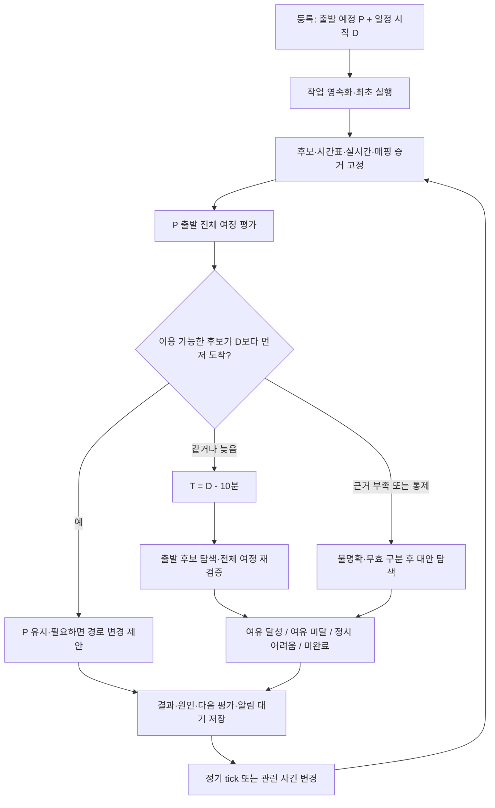

# 출발 예정시각 유지·조건부 10분 여유 적용 — 계산 정책

- 수정일: 2026-09-16, Asia/Seoul.
- 상태: **구현 전 목표 설계. 실행 코드·기계 스키마·운영 설정의 변경이 아니다.**
- 사용자 확정: **출발 예정시각과 일정 시작시각을 모두 입력**한다. 예상 도착이 일정 시작보다 빠르면 출발을 유지하고, 같거나 늦으면 일정 시작 **10분 전**을 목표로 최신 출발을 탐색한다.
- 이전 문서의 ‘일정 시작시각만 입력’, ‘항상 도착 기준 역산’, ‘출발 입력 제거’ 제안을 대체한다.
- 작업 지침: [파트별 구현 계획](arrival-deadline-implementation-plan.md). 원천·컬럼·매핑: [데이터 구현 가이드](arrival-deadline-data-guide.md).
- 기존 코드 확인 기준: `b994af1`. 문서 커밋을 구현 완료 근거로 사용하지 않는다.

## 1. 시각과 값의 소유권

| 기호/필드 | 정의 | 소유자 |
|---|---|---|
| `P / plannedDepartAt` | 현재 사용자 출발 계획. 최초에는 직접 입력한 출발 예정시각 | 사용자. 명시적 추천 수락도 계획 변경으로 기록 |
| `userInputDepartAt` | 마지막으로 직접 입력한 출발시각. 수락 전후 비교용 | 사용자 입력 이력 |
| `D / arriveBy` | 일정 시작시각 | 사용자 |
| `asOf` | 평가 현재시각·정보 기준시각 | 서버가 평가 시작 때 고정 |
| `A(r,d,E)` | 증거 스냅샷 E로 경로 r을 d에 출발했을 때의 전체 예상 도착 | 공통 여정 계산기 |
| `durationSeconds` | `A(r,d,E) - d`. 도보·대기·탑승·환승의 중복 없는 합 | 계산기 |
| `T` | 조건부 재탐색 목표 `D - 600초` | 정책 |
| `proposedDepartAt` | 제시한 출발. 자동으로 사용자 입력에 덮어쓰지 않음 | 추천 결과 |
| `actualDepartAt` | 사용자가 출발을 확인한 시각 등 실제 이동 증거 | 이동 상태 |

신규 일정은 P,D를 필수로 받고 `P < D`를 검증한다. 시간대 없는 기존 API 입력은 Asia/Seoul로 해석하고, 평가 결과는 `+09:00` ISO 8601로 반환한다. **초 단위로 비교**하며 화면의 분 반올림 값을 판정에 사용하지 않는다. 과거 출발 계획은 5절을 따른다.

## 2. 사용자 확정 분기

### 2.1 예정 출발로 일정 시작 전에 도착하면 유지

```text
A = P + 해당 출발시각에서 계산한 전체 소요시간
A < D:
    proposedDepartAt = P
    targetArriveAt = D
    appliedBufferSeconds = 0
    decision = KEEP_DEPARTURE
```

8시 30분 출발, 일정 9시, 소요 29분이면 8시 59분 도착이므로 **8시 30분을 유지**한다. 여유가 1분이어도 이 분기에서 10분을 강제로 확보하지 않는다. 더 늦게 출발할 수 있어도 출발을 늦추지 않는다.

### 2.2 같거나 늦으면 10분 전 도착 목표로 탐색

```text
A >= D:
    T = D - 600초
    targetArriveAt = T
    appliedBufferSeconds = 600
    d* = 실행 가능한 후보 중 A(r,d,E) <= T를 만족하는 가장 늦은 d
```

8시 30분 출발, 소요 30분이면 **정확히 9시 도착도 재탐색 대상**이다. 목표는 8시 50분, 소요가 일정한 예제의 새 출발은 8시 20분이다. 실제 대중교통에서는 출발이 바뀌면 차량·대기·환승도 바뀌므로 단순 뺄셈만으로 확정하지 않는다.

10분은 목표를 앞당기는 데 한 번만 적용한다. 소요시간에 추가로 10분을 더하거나, 구간마다 더하거나, 재계산할 때마다 목표를 10분씩 더 앞당기지 않는다. **T에 정확히 도착하면 성공(`<= T`)**이다. 최초 유지 판정의 `< D`와 의도적으로 다르다.

### 2.3 다중 후보 처리 — 구현 기본안

사용자가 정한 시간 비교 규칙에 아래 후보 선택 기본안을 결합한다. 세부 순위는 버전 관리할 제품 정책이며 사용자 확정 사항과 구분한다.

1. 선택 경로가 P에 출발해 이용 가능하고 `A < D`이면 그대로 유지한다.
2. 선택 경로가 늦거나 무효이면 같은 P의 대안을 먼저 비교한다.
3. 같은 P에서 `A < D`인 대안이 있으면 **출발 유지 + 경로 변경 제안**이다. 사용자 선택 경로를 자동 변경하지 않는다.
4. 비교 가능한 후보가 모두 `A >= D`이면 T로 재탐색한다. 선택 경로가 없으면 품질 조건을 통과한 P 출발 후보부터 비교한다.
5. 확정 통제로 경로가 무효이고 P의 대안도 없으면 복구 탐색을 한다. trigger를 ‘통제’로 남기고 수치 ETA가 늦은 경우와 구별한다.
6. 후보 ETA가 불명확하면 ‘모두 늦음’을 확정하지 않는다. 확인 가능한 대안과 정보 부족을 함께 반환한다.

‘최신 출발’은 외부 API가 제공한 후보와 검증한 탐색 범위에 한정한다. 전 교통망의 최적해라는 뜻이 아니다. 품질을 통과한 후보의 동률 기본안은 출발 늦은 순, 도착 빠른 순, 환승 적은 순, 도보 짧은 순, 안정적인 후보 ID 순이다.

## 3. 전체 처리 흐름



수집은 사용자마다 실행하지 않고 노선·역·도로별로 공유한다. 등록 트랜잭션에서는 일정과 평가 작업을 저장한다. 외부 API는 커밋 후 작업자가 호출하고, DB 스케줄러가 누락·재시작을 복구한다.

## 4. 전체 소요시간 계산

순서는 `접근 도보 → 정류장/승강장 도착 → 대기 → 탑승 이동 → 환승 이동 → 다음 차량 대기 → … → 최종 도보`다. 앞 구간 종료시각이 다음 구간 진입시각이다. 버스 ML의 날짜·hourSlot도 해당 진입 예상시각에서 결정한다. 차량을 놓치면 다음 확인 가능한 차량을 선택해 이후 여정을 다시 계산한다.

| 요소 | 입력 | 제약·fallback |
|---|---|---|
| 일반 도보·환승 이동 | 경로 API의 WALK 시간 | 미검증 별도 환승 보정 가산 금지 |
| 버스 대기 | 도착 후 탑승 가능한 실시간 첫째/둘째 차량 | 셋째 차량 생성 금지. 미래는 검증된 배차 정책 또는 API fallback |
| 버스 이동 | 인접 edge ML 또는 검증된 기준선 정책 | PREVIEW 모델은 운영 출발 변경의 단독 근거로 사용하지 않음 |
| 지하철 | 동일 운행일·열차·방향·행선지 시간표와 실시간 | 하차역 예측이 없으면 정적 이동시간 사용 한계를 표시 |
| 통제·중단 | 검증된 방향·적용시간·차량 범위 | 완전 통제면 제외. 부분 통제에 임의 지연분 가산 금지 |
| 데이터 누락 | 유효한 시간표·기준선·API 추정 | 알려진 운행 중단을 정상 시간표로 덮지 않음 |

카카오 총시간과 step 합의 차이 `unassignedDurationSeconds`를 대기로 단정하지 않는다. 분해 검증 없이 기존 총시간에 새 대기를 더하지 않는다. 같은 비용 범위라는 증거가 있을 때만 구성요소를 교체한다.

## 5. 최신 출발 탐색·예외

### 5.1 범위와 과거 출발

기본 탐색 범위는 `[asOf, min(P,T)]`로 제안한다. 기존 계획 유지 또는 조기 출발 기능이므로 P보다 늦은 출발을 자동 권고하지 않는다. 이전 일정 때문에 출발 가능한 시각이 따로 있다면 하한은 `max(asOf, previousScheduleAvailableAt)`이다.

P가 과거이고 출발 확인이 없으면 P를 실행 가능한 추천으로 반환하지 않는다. 원래 P는 보존하고 `effectiveDepartAt=asOf`, `departureMissed=true`로 ‘지금 출발’의 도착을 계산한다. T도 과거라면 실행 가능한 10분 여유 경로 탐색을 건너뛰고 대안 분기로 간다.

### 5.2 탐색 방법

1. 시간표가 있는 경로는 T 이전 도착 운행에서 탑승·환승 연결을 역으로 찾고 접근 도보를 차감하여 출발 후보를 만든다.
2. 그 후보를 동일한 **정방향 여정 계산기**로 다시 검증한다. 실시간 변경으로 시간표 연결이 깨질 수 있다.
3. 현재 외부 후보·데이터 범위에서 시간표 후보와 제한된 출발 격자를 사용한다. 전체 대중교통망 탐색 엔진을 새로 만드는 과제로 확대하지 않는다.
4. 버스 배차 추정·ML만으로 연속 최적해를 증명할 수 없으면 ‘검증한 격자 내 최선’과 범위·해상도를 기록한다.
5. 이분 탐색은 도착함수의 단조성이 검증된 구간에만 사용한다. 시간표·환승·통제 경계를 포함한 전체 여정에 무조건 적용하지 않는다.
6. 탐색 전체에서 원본 스냅샷·모델 버전·입력별 캐시를 공유하되 진입시각·차량 선택은 다시 계산한다. 출발 1분 변경마다 외부 API를 다시 호출하지 않는다.
7. 후보 수·평가 횟수·시간 예산이 끝나면 `SEARCH_INCOMPLETE`와 현재 최선을 반환한다. 탐색 실패를 도착 불가능이라고 표시하지 않는다.

### 5.3 결과 상태

아래 decision은 **새 계약 제안**이다. 실행 상태(PENDING 등), 품질(PREVIEW 등)과 별도 축이다.

| decision | 조건 | 안내 |
|---|---|---|
| `KEEP_DEPARTURE` | 실행 가능한 P의 후보가 `A < D` | 입력 출발 유지, 실제 ETA |
| `DEPART_NOW` | P는 지났으나 지금 출발하면 `A < D` | 지난 계획 유지로 표시하지 않고 지금 출발 대안 제공 |
| `ADVANCE_DEPARTURE` | 새 출발로 `A <= T` | ‘8시 20분 출발 → 8시 50분 도착 예상’ |
| `MARGIN_UNAVAILABLE` | T는 불가지만 실행 가능한 출발로 `A < D` 가능 | 10분 여유는 어렵지만 일정 전 도착 예상 |
| `ON_TIME_UNLIKELY` | 검증 범위의 실행 가능한 후보가 모두 `A >= D` | 가장 빠른 도착 경로, ETA·지각초 |
| `DATA_INSUFFICIENT` | 이용 가능성·ETA의 필수 근거 부족 | 추정·누락 범위·갱신시각 |
| `NO_USABLE_ROUTE` | 지원 후보가 운행 종료·확정 통제 등으로 전부 무효 | 이용 불가 근거·지원 범위 |
| `SEARCH_INCOMPLETE` | 탐색 예산 소진 | 발견한 대안과 미완료 표시 |

`latenessSeconds=max(0, ETA-D)`다. 정확히 D에 도착하면 지각초는 0이지만 `< D`를 만족하지 않는다. ‘일정 시작과 동시에 도착 예상, 여유 없음’으로 설명한다.

탐색 예산이 끝나면 실행 가능한 후보를 찾았더라도 SEARCH_INCOMPLETE를 반환하고 후보의 조건 충족 여부는 `bestKnownDecision`에 별도로 남긴다. 미완료 후보를 확정된 최신 출발이라고 표시하지 않는다.

과거에 출발했다면 가능했을 시각은 별도 `historicalFeasibleDepartAt`에만 둔다. 당시 운행·증거를 검증할 수 없으면 null이다. 현재 지연정보를 과거에 소급해 정시 가능성을 확정하지 않는다.

## 6. 재계산 주기와 동시성

사용자 지정 기본 주기는 **D(일정 시작)** 기준이다. 기존 코드의 출발 기준 정책을 그대로 두지 않는다.

| 시점 | 실행 |
|---|---|
| 등록 직후 | 최초 1회 |
| D−60 ~ D−30분 | −60, −50, −40, −30분 |
| D−30 ~ D−10분 | −25, −20, −15, −10분 |
| D−10분 ~ D | −9, −8, …, −1, 0분 |
| 일정 수정·수락·사건 변경 | 주기 외 즉시 평가 요청, 동일 일정 요청 합침 |

늦게 등록하면 과거 tick을 몰아서 재생하지 않고 즉시 평가 후 다음 미래 tick을 예약한다. D 이후 출발 미확인이면 정시 출발 추천 루프를 종료하고 사용자 상태 확인으로 전환한다.

**추가 안전장치 제안:** P가 D−60분보다 이르면 기본 주기에 출발 전 공백이 있다. P−10분·P 직전의 추가 확인을 기본 tick과 합치는 안을 제품 정책으로 별도 채택한다. 이것은 사용자가 확정한 기본 주기를 출발 기준으로 몰래 변경하는 것이 아니다. 미채택 시 장거리 출발 전 관측 공백을 명시한다.

일정·평가 작업은 함께 커밋하고 외부 I/O는 트랜잭션 밖에서 수행한다. 완료 저장은 `inputVersion`, lease 소유권, 사건 revision을 검사한다. 수정·취소·출발 이후 도착한 이전 결과를 폐기한다. 계산 중 사건 변경은 다음 최신 평가를 예약하며 오래된 결과로 새 결과를 덮지 않는다.

## 7. 통제·지연·원인

- 도로는 통과 링크와 사건 링크의 namespace·방향·적용시간·차량 범위가 검증돼야 직접 영향이다. 좌표 근접이나 ‘사고’ 문자열만으로 차단하지 않는다.
- 구간 진입~이탈 예상시간과 사건 유효구간의 겹침을 검사한다. 앞 구간 지연으로 통과시각이 바뀌면 다시 판단한다.
- 지하철은 운행일·노선·방향·열차·정차 순서를 연결한다. ETA 변화, 검증된 시간표 대비 지연, 공식 장애 원인을 구별한다.
- 한 역의 5분 지연을 모든 역·열차에 더하지 않는다. 미관측 하차시각은 추정으로 남긴다.
- 원인 미확인 ETA 증가는 **‘예상 소요시간이 늘어났습니다. 원인은 확인 중입니다.’**로 안내한다. ‘교통량 증가’도 별도 관측 없이 단정하지 않는다.
- 원천 사건 ID·revision·영향 구간을 보존한다. 여러 사건의 지연초를 근거 없이 분배하지 않는다.
- 만료·수집 실패·불완전 목록에서의 미등장은 상황 해제가 아니다. 명시적 종료 또는 종료 판정 가능한 완전 스냅샷 계약이 있어야 해제한다.

## 8. 품질·이동 중·알림

실시간 반영 여부, 원천 시각, 매핑 품질, fallback, 표본 수, 모델·시간표·정책 버전, 결과 유효기간을 남긴다. 평균 예측을 P80/P95로 표시하지 않는다. 구간 분위수 합을 전체 경로 도착확률로 해석하지 않는다. 조건부 10분 목표와 예측 오차/신뢰도는 별개다.

출발 후에는 과거 출발시각 변경 권고를 중단한다. 현재 위치·시각·탑승 상태에서 남은 여정을 평가한다. 권한 거절·오래된 위치면 정확한 우회 경로를 만들어 내지 않는다. 현재 `/departure`의 감시 중단만으로 이동 중 재탐색이 완성된 것은 아니다.

동일 평가 재처리·동일 사건 재수집은 중복 알림을 만들지 않는다. 통제·정시 가능성 변화·출발 변경·경로 변경·확인된 해제를 구별한다. PREVIEW 운영 권고 제한을 이번 문서만으로 해제하지 않는다. 공식 통제 사실 전달은 예측 모델 승인과 별도로 검증할 수 있다.

## 9. 손계산 검증 사례

기본 fixture: D=09:00, P=08:30, asOf=08:00. 소요시간은 별도 기재가 없으면 출발에 무관하다.

| 사례 | 기대 결과 |
|---|---|
| 소요 20분 → 08:50 | P 유지, buffer=0 |
| 소요 29분 59초 → 08:59:59 | P 유지, buffer=0 |
| 소요 30분 → 09:00 | T=08:50, 출발 08:20, buffer=600 |
| 소요 31분 → 09:01 | T=08:50, 출발 08:19 |
| 새 출발 08:20에서 08:50 도착 | 목표와 같으므로 성공 |
| 08:20은 환승 실패로 08:55, 08:17은 08:49 | 산술 08:20을 확정하지 않고 전체 여정 재검증 |
| asOf=08:25, 소요 30분 | 지금 출발 08:55 도착, MARGIN_UNAVAILABLE |
| asOf=08:35, 소요 30분 | 과거 P 권고 금지, 지금 출발 09:05·지각 300초 |
| 선택 경로 09:03, 대안 같은 P에서 08:58 | P 유지 + 경로 변경 제안 |
| ETA는 08:59지만 완전 통제 | 이용 가능한 후보에서 제외 |
| 선택 경로 통제, 대안 ETA 미확인 | 통제 표시, 전체 후보 지각 단정 금지 |
| 사건 만료·수집 실패 | 해제 알림 금지, UNKNOWN/fallback |
| P 또는 D 수정 | 이전 inputVersion 폐기, 새 입력으로 평가 |
| 추천 수락 후 재계산 | 수락한 P가 현재 계획. 직접 입력 이력 보존, T는 항상 D−600 |
| ML PREVIEW만 존재 | 품질 제한 표시, 운영 권고 수락 제한 유지 |
| 전날 23:30 출발, 다음 날 01:00 일정 | 절대시각·운행일 구분, 24시 초과 시간표 정상 변환 |
