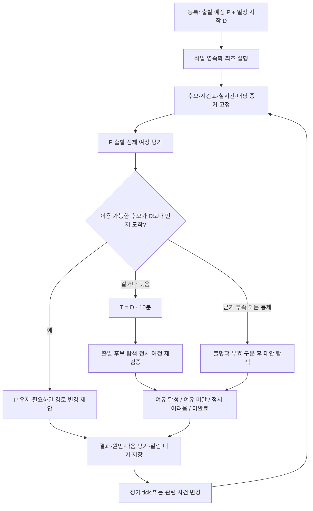

# 출발 예정시각 유지·조건부 10분 여유 적용 — 계산 정책

- 수정일: 2026-09-16, Asia/Seoul.
- 상태: **구현 전 목표 설계. 실행 코드·기계 스키마·운영 설정의 변경이 아니다.**
- 사용자 확정: **출발 예정시각과 일정 시작시각을 모두 입력**한다. 예상 도착이 일정 시작보다 빠르면 출발을 유지하고, 같거나 늦으면 일정 시작 **10분 전**을 목표로 최신 출발을 탐색한다.
- 이전 문서의 ‘일정 시작시각만 입력’, ‘항상 도착 기준 역산’, ‘출발 입력 제거’ 제안을 대체한다.
- 작업 지침: [파트별 구현 계획](arrival-deadline-implementation-plan.md). 원천·컬럼·매핑: [데이터 구현 가이드](arrival-deadline-data-guide.md).
- 기존 코드 확인 기준: `b994af1`. 문서 커밋을 구현 완료 근거로 사용하지 않는다.

## 0. 이 계산에 필요한 데이터는 별도 확보 대상이다

아래 흐름은 목표 계산 순서이며, 사용자가 모든 데이터를 가지고 있다는 가정이 아니다. 상세 출처·필드·확보 방법은 [데이터 가이드 0절](arrival-deadline-data-guide.md#0-먼저-확인할-데이터-확보-현황과-확보-작업)을 먼저 확인한다.

| 계산에 들어갈 것 | 어디에서 얻는가 | 확보 전 처리 |
|---|---|---|
| P,D,출발지·목적지 | 사용자 일정 입력 | 필수 입력 요청 |
| 경로 후보·원본 도보/환승시간 | 카카오 경로 응답 S02 | API 권한/응답 실패 시 계산 불가 상태 |
| 별도 접근·이탈 도보 | 카카오모빌리티 제휴 도보 S02-W | 제휴·endpoint 미확보 시 원본 WALK fallback |
| 버스 대기·위치 | 서울 버스 도착 S03·위치 S04 | 지원 범위/신선도 검증 전 실시간 사용 금지 |
| 지하철 예정·실시간 운행 | 서울교통공사 시간표 S05·서울 도착/위치 S06/S07 | 확보한 시간표만 추정에 사용. 열차 대응 미확정이면 실시간 결합 금지 |
| 통제·장애 사유 | 지하철 공지 S08·도로 돌발 S09·TOPIS 공지 S12-N | 직접 영향 근거 없으면 원인 미확인/영향 가능성 |
| 사건과 경로 연결 | 공식 노선/정류장/역 마스터·도로 연결 S10 | 매핑 미확보면 확정 차단 불가 |
| 링크 속도·날씨 | S14 도로 소통·S11 관측/예보 | 미확보 필드 0 대입이나 임의 지연분 생성 금지 |
| ML·분위수·구간 상태 | 위 원천·실측을 처리한 내부 산출물 S13 | 실제 정답/표본/운영 승인 없으면 PREVIEW/unknown |

‘전체 여정 재계산’은 해당 범위의 데이터가 검증됐을 때 가능한 기능이다. 특히 모든 역의 미래 예측, 차량별 실제 통과기록, 공식 열차 ID 대응표, 실제 통제 해제는 확보가 확인되지 않았다. 부족한 범위를 응답의 qualityReasons에 표시하고 결과를 정상 실시간 계산처럼 제공하지 않는다.

## 1. 시각과 값의 소유권

| 기호/필드 | 정의 | 소유자 |
|---|---|---|
| `P / plannedDepartAt` | 현재 사용자 출발 계획. 최초에는 직접 입력한 출발 예정시각 | 사용자. 명시적 추천 수락도 계획 변경으로 기록 |
| `userInputDepartAt` | 마지막으로 직접 입력한 출발시각. 수락 전후 비교용 | 사용자 입력 이력 |
| `D / arriveBy` | 일정 시작시각 | 사용자 |
| `asOf` | 평가 현재시각·정보 기준시각 | 서버가 평가 시작 때 고정 |
| `A(r,d,E)` | 증거 스냅샷 E로 경로 r을 d에 출발했을 때의 전체 예상 도착 | 공통 여정 계산기 |
| `durationSeconds` | `A(r,d,E) - d`. 도보·대기·탑승·환승의 중복 없는 합 | 계산기 |
| `T` | 조건부 재탐색 목표 `D - 600초` | 정책 |
| `proposedDepartAt` | 제시한 출발. 자동으로 사용자 입력에 덮어쓰지 않음 | 추천 결과 |
| `actualDepartAt` | 사용자가 출발을 확인한 시각 등 실제 이동 증거 | 이동 상태 |

신규 일정은 P,D를 필수로 받고 `P < D`를 검증한다. 시간대 없는 기존 API 입력은 Asia/Seoul로 해석하고, 평가 결과는 `+09:00` ISO 8601로 반환한다. **초 단위로 비교**하며 화면의 분 반올림 값을 판정에 사용하지 않는다. 과거 출발 계획은 5절을 따른다.

## 2. 사용자 확정 분기

### 2.1 예정 출발로 일정 시작 전에 도착하면 유지

```text
A = P + 해당 출발시각에서 계산한 전체 소요시간
A < D:
    proposedDepartAt = P
    targetArriveAt = D
    appliedBufferSeconds = 0
    decision = KEEP_DEPARTURE
```

8시 30분 출발, 일정 9시, 소요 29분이면 8시 59분 도착이므로 **8시 30분을 유지**한다. 여유가 1분이어도 이 분기에서 10분을 강제로 확보하지 않는다. 더 늦게 출발할 수 있어도 출발을 늦추지 않는다.

### 2.2 같거나 늦으면 10분 전 도착 목표로 탐색

```text
A >= D:
    T = D - 600초
    targetArriveAt = T
    appliedBufferSeconds = 600
    d* = 실행 가능한 후보 중 A(r,d,E) <= T를 만족하는 가장 늦은 d
```

8시 30분 출발, 소요 30분이면 **정확히 9시 도착도 재탐색 대상**이다. 목표는 8시 50분, 소요가 일정한 예제의 새 출발은 8시 20분이다. 실제 대중교통에서는 출발이 바뀌면 차량·대기·환승도 바뀌므로 단순 뺄셈만으로 확정하지 않는다.

10분은 목표를 앞당기는 데 한 번만 적용한다. 소요시간에 추가로 10분을 더하거나, 구간마다 더하거나, 재계산할 때마다 목표를 10분씩 더 앞당기지 않는다. **T에 정확히 도착하면 성공(`<= T`)**이다. 최초 유지 판정의 `< D`와 의도적으로 다르다.

### 2.3 다중 후보 처리 — 구현 기본안

사용자가 정한 시간 비교 규칙에 아래 후보 선택 기본안을 결합한다. 세부 순위는 버전 관리할 제품 정책이며 사용자 확정 사항과 구분한다.

1. 선택 경로가 P에 출발해 이용 가능하고 `A < D`이면 그대로 유지한다.
2. 선택 경로가 늦거나 무효이면 같은 P의 대안을 먼저 비교한다.
3. 같은 P에서 `A < D`인 대안이 있으면 **출발 유지 + 경로 변경 제안**이다. 사용자 선택 경로를 자동 변경하지 않는다.
4. 비교 가능한 후보가 모두 `A >= D`이면 T로 재탐색한다. 선택 경로가 없으면 품질 조건을 통과한 P 출발 후보부터 비교한다.
5. 확정 통제로 경로가 무효이고 P의 대안도 없으면 복구 탐색을 한다. trigger를 ‘통제’로 남기고 수치 ETA가 늦은 경우와 구별한다.
6. 후보 ETA가 불명확하면 ‘모두 늦음’을 확정하지 않는다. 확인 가능한 대안과 정보 부족을 함께 반환한다.

‘최신 출발’은 외부 API가 제공한 후보와 검증한 탐색 범위에 한정한다. 전 교통망의 최적해라는 뜻이 아니다. 품질을 통과한 후보의 동률 기본안은 출발 늦은 순, 도착 빠른 순, 환승 적은 순, 도보 짧은 순, 안정적인 후보 ID 순이다.

## 3. 전체 처리 흐름



수집은 사용자마다 실행하지 않고 노선·역·도로별로 공유한다. 등록 트랜잭션에서는 일정과 평가 작업을 저장한다. 외부 API는 커밋 후 작업자가 호출하고, DB 스케줄러가 누락·재시작을 복구한다.

## 4. 전체 소요시간 계산

순서는 `접근 도보 → 정류장/승강장 도착 → 대기 → 탑승 이동 → 환승 이동 → 다음 차량 대기 → … → 최종 도보`다. 앞 구간 종료시각이 다음 구간 진입시각이다. 버스 ML의 날짜·hourSlot도 해당 진입 예상시각에서 결정한다. 차량을 놓치면 다음 확인 가능한 차량을 선택해 이후 여정을 다시 계산한다.

### 4.1 일정 등록 후 경로 분해·매핑·도보 보강 순서

아래 순서를 하나의 후보 조립 과정으로 수행한다. 별도 도보 API 결과를 카카오 전체시간에 단순 추가하지 않는다.

```text
사용자 출발지·목적지 WGS84 좌표
  → 카카오 대중교통 경로 후보 조회
  → routes[].steps[]를 BUS / SUBWAY / WALK로 파싱
  → BUS·SUBWAY를 공식 마스터로 EXACT/PARTIAL/AMBIGUOUS/UNMAPPED 판정
  → 첫 대중교통 승차 좌표와 마지막 대중교통 하차 좌표 확정
  → 출발지→첫 승차지 ACCESS_WALK를 카카오 도보 API로 조회
  → 마지막 하차지→목적지 EGRESS_WALK를 카카오 도보 API로 조회
  → 대중교통 사이 WALK를 TRANSFER_WALK로 분류
  → 접근 도보부터 최종 도보까지 시간순으로 전체 여정 재조립
```

WALK의 역할은 배열 위치만으로 이름을 붙이지 않고 양옆의 실제 대중교통 step을 확인한다.

| 역할 | 판정 | 시간 원천 |
|---|---|---|
| `ACCESS_WALK` | 첫 BUS/SUBWAY 이전의 이동 | 별도 카카오 도보 API 성공값. 실패·권한 없음이면 검증된 대중교통 WALK fallback |
| `TRANSFER_WALK` | BUS/SUBWAY 두 step 사이의 WALK | 카카오 대중교통 응답의 WALK 유지. 별도 환승 자료로 교체할 때 동일 비용 범위 검증 |
| `EGRESS_WALK` | 마지막 BUS/SUBWAY 이후의 이동 | 별도 카카오 도보 API 성공값. 실패·권한 없음이면 검증된 대중교통 WALK fallback |

첫/마지막 대중교통 step의 `path.points` 시작·끝은 카카오 승·하차 **후보 좌표**다. 카카오 stop 객체는 현재 저장소 fixture와 DTO에서 이름만 제공하므로 이 좌표를 곧바로 확정하지 않는다. BUS/SUBWAY 마스터 매핑이 EXACT이면 공식 정류장·역 좌표와 거리·순서·방향을 대조한다. 허용 오차 안에서 하나로 확인된 좌표만 도보 API의 endpoint로 사용한다. 좌표가 없거나 충돌하거나 매핑이 모호하면 별도 도보 호출을 생략하고 fallback 사유를 남긴다.

카카오 도보 길찾기는 제휴 파트너 전용이다. 제휴 권한과 별도 host·service 헤더·호출 한도를 운영에서 확인해야 한다. 일반 카카오 REST 키가 있다는 이유만으로 사용 가능하다고 보지 않는다.

| 요소 | 입력 | 제약·fallback |
|---|---|---|
| 접근·이탈 도보 | 검증된 승·하차 좌표로 호출한 카카오 제휴 도보 API | 권한·좌표·응답 실패 시 대중교통 WALK fallback. 중복 가산 금지 |
| 환승 이동 | 카카오 대중교통 응답의 해당 WALK | 미검증 별도 환승 보정 가산 금지 |
| 버스 대기 | 도착 후 탑승 가능한 실시간 첫째/둘째 차량 | 셋째 차량 생성 금지. 미래는 검증된 배차 정책 또는 API fallback |
| 버스 이동 | 인접 edge ML 또는 검증된 기준선 정책 | PREVIEW 모델은 운영 출발 변경의 단독 근거로 사용하지 않음 |
| 지하철 | 동일 운행일·열차·방향·행선지 시간표와 실시간 | 하차역 예측이 없으면 정적 이동시간 사용 한계를 표시 |
| 통제·중단 | 검증된 방향·적용시간·차량 범위 | 완전 통제면 제외. 부분 통제에 임의 지연분 가산 금지 |
| 데이터 누락 | 유효한 시간표·기준선·API 추정 | 알려진 운행 중단을 정상 시간표로 덮지 않음 |

카카오 총시간과 step 합의 차이 `unassignedDurationSeconds`를 대기로 단정하지 않는다. 분해 검증 없이 기존 총시간에 새 접근·이탈 도보 또는 대기를 더하지 않는다. ACCESS/EGRESS WALK가 대중교통 step에 이미 있으면 같은 역할을 **교체**하고, 없으면 provider 전체시간에 해당 비용이 숨어 있을 수 있으므로 비용 범위 검증 후 componentized 계산으로 전환한다. 검증 실패 시 별도 도보 결과를 표시용 근거로만 보존하고 provider 전체시간 fallback을 유지한다.

### 4.2 버스 구간 계산 절차

버스 step은 `승차 정류장 도착시각 → 탑승 가능한 차량 선택 → 인접 edge별 이동 → 하차시각` 순서로 계산한다. 카카오 step의 소요시간에 실시간 대기와 ML 이동시간을 함께 더하는 방식은 비용을 중복시킬 수 있으므로 사용하지 않는다.

```text
입력: mapped BUS step, platformArriveAt, EvaluationSnapshot
1. routeId + boardStopId + alightStopId + occurrence로 마스터 edge 목록을 찾는다.
2. 매핑이 EXACT가 아니면 실시간/ML 교체를 중단하고 provider fallback 품질을 남긴다.
3. boardStop 도착 이후의 실시간 도착 후보를 원천 발생시각 기준으로 정렬한다.
4. 운행 종료·우회·만차 등 원천 코드로 탑승 불가인 차량을 제외한다.
5. 확인 가능한 첫째, 필요하면 둘째 차량까지만 고른다. 없는 셋째 차량을 배차간격으로 합성하지 않는다.
6. 차량 도착시각을 boardAt으로 정하고 각 인접 edge 진입시각으로 ML/기준선 입력 hourSlot을 다시 만든다.
7. 모든 edge가 동일한 운영 가능 모델·마스터 버전으로 평가되면 edge 시간을 합한다.
8. 일부 edge만 유효하면 provider BUS step 전체시간 또는 하나의 검증된 기준선 정책으로 fallback한다.
9. alightAt을 다음 WALK/TRANSFER의 시작시각으로 넘긴다.
```

실시간 버스 도착의 기준은 `mkTm + exps` 또는 원천 계약이 정의한 절대 ETA다. `collectedAt + exps`로 바꾸지 않는다. 차량 위치는 도착예측을 검증하거나 순서 역전을 찾는 보조 증거이며, 정류장 간 거리만으로 도착시각을 새로 만들지 않는다. 출발 후보가 바뀌어 승차 정류장 도착시각이 첫 차량보다 늦어지면 둘째 차량부터 전체 뒷구간을 다시 계산한다.

### 4.3 지하철 구간 계산 절차

지하철은 노선 평균 지연을 기존 총시간에 더하지 않고 운행 하나를 선택한 뒤 정차시각을 다시 연결한다.

```text
입력: mapped SUBWAY step, platformArriveAt, serviceDate, EvaluationSnapshot
1. 노선·방향·승차역·하차역·급행/지선 패턴이 일치하는 정적 trip을 조회한다.
2. 24시 초과 시간은 해당 serviceDate의 절대시각으로 변환한다.
3. platformArriveAt 이후 승차 가능한 trip만 남기고 취소·무정차·운행중단 범위를 제외한다.
4. staticTripKey와 실시간 providerTrainId의 EXACT crosswalk가 있을 때만 실시간 정차예측을 결합한다.
5. 승차역 예측이 있으면 실제 탑승 가능시각을, 하차역 예측도 있으면 실제 하차예상시각을 사용한다.
6. 하차역 예측이 없으면 동일 trip의 정적 역간 시간을 사용하되 quality=ESTIMATED와 누락 범위를 남긴다.
7. 다음 환승 승차시각보다 늦어지면 놓친 환승을 유지하지 않고 다음 trip을 선택한다.
8. 막차가 끝났으면 다음 운행일 첫차를 같은 날의 대기시간으로 연결하지 않는다.
```

실시간 열차 위치와 도착정보가 서로 충돌하면 갱신시각만 보고 하나를 정상으로 채택하지 않는다. 같은 운행일·열차·방향·정차순서가 확인되지 않으면 실시간 결합을 거부하고 정적 시간표 또는 정보 부족으로 낮춘다. 공지는 원인과 운행 가능성 증거이고, 분 단위 지연값은 정차예측 또는 검증된 운행 기록에서 계산한다.

### 4.4 도로 사건과 경로 이용 가능성 판정

도로 사건은 아래 조건을 모두 만족할 때만 해당 edge의 직접 원인이다.

```text
sameNamespace
AND mappingStatus == EXACT
AND directionMatches
AND affectedModeContains(routeMode)
AND [edgeEnterAt, edgeExitAt) overlaps [incidentStartAt, incidentEndAt)
```

`restriction=FULL`이고 위 조건이 모두 맞으면 해당 후보를 이용 불가로 처리한다. PARTIAL/UNKNOWN은 경로를 자동 제외하지 않는다. 관측 속도·제공자 재조회·검증된 모델이 새 이동시간을 산출한 경우에만 ETA를 바꾸며, 사건 종류별 고정 5분 같은 임의 가산은 금지한다. 앞 구간 지연으로 edge 통과 예정시각이 달라지면 사건 시간 겹침도 다시 검사한다.

### 4.5 하나의 완성된 timeline과 비용 범위

계산 결과는 각 leg마다 `role, source, startAt, endAt, durationSeconds, quality, sourceGeneratedAt, validUntil, mappingVersion, causeRefs`를 갖는다. 연속한 leg는 앞 leg의 `endAt`과 다음 leg의 `startAt`이 같아야 하고, 설명되지 않은 양수 간격은 `UNASSIGNED`로 남긴다. 이를 자동으로 WAIT로 바꾸지 않는다.

`costCoverage`는 `COMPONENTIZED`, `PROVIDER_TOTAL`, `PARTIAL` 중 하나다. COMPONENTIZED는 접근 도보부터 최종 도보까지 모든 시간을 겹침 없이 설명할 때만 사용한다. PROVIDER_TOTAL에서는 별도 도보·실시간 대기·ML 값을 총시간에 가산하지 않고 비교 근거로만 남긴다. PARTIAL 결과는 수치 ETA가 있더라도 최신 출발 확정에 단독 사용하지 않는다.

### 4.6 후보 평가 출력

각 후보 평가는 최소 다음을 반환한다.

| 필드 | 생성 규칙 |
|---|---|
| `candidateId`, `routeId` | 카카오 후보와 저장 route를 안정적으로 연결 |
| `requestedDepartAt`, `effectiveDepartAt` | 사용자/탐색 입력과 과거 P 보정 결과를 분리 |
| `estimatedArriveAt`, `durationSeconds` | 완성 timeline의 첫 시작과 마지막 종료에서 계산 |
| `usable` | 확정 통제·운행 종료·필수 매핑 실패 등 숫자 ETA와 별도 판정 |
| `quality`, `qualityReasons[]` | LIVE/ESTIMATED/FALLBACK/PREVIEW/INSUFFICIENT와 근거 |
| `timeline[]` | 위 leg 계약. UI 표시값도 이 합과 일치해야 함 |
| `causes[]` | 실제 결과에 영향을 준 사건 revision과 edge/trip 범위만 포함 |
| `snapshotRef` | asOf, source revision, master/model/policy version hash |

후보 정렬 전에 `usable=false`와 `quality=INSUFFICIENT`를 늦은 ETA 하나로 축약하지 않는다. 같은 snapshot을 사용한 후보끼리만 정시 여부와 최신 출발을 비교한다.

## 5. 최신 출발 탐색·예외

### 5.1 범위와 과거 출발

기본 탐색 범위는 `[asOf, min(P,T)]`로 제안한다. 기존 계획 유지 또는 조기 출발 기능이므로 P보다 늦은 출발을 자동 권고하지 않는다. 이전 일정 때문에 출발 가능한 시각이 따로 있다면 하한은 `max(asOf, previousScheduleAvailableAt)`이다.

P가 과거이고 출발 확인이 없으면 P를 실행 가능한 추천으로 반환하지 않는다. 원래 P는 보존하고 `effectiveDepartAt=asOf`, `departureMissed=true`로 ‘지금 출발’의 도착을 계산한다. T도 과거라면 실행 가능한 10분 여유 경로 탐색을 건너뛰고 대안 분기로 간다.

### 5.2 탐색 방법

1. 시간표가 있는 경로는 T 이전 도착 운행에서 탑승·환승 연결을 역으로 찾고 접근 도보를 차감하여 출발 후보를 만든다.
2. 그 후보를 동일한 **정방향 여정 계산기**로 다시 검증한다. 실시간 변경으로 시간표 연결이 깨질 수 있다.
3. 현재 외부 후보·데이터 범위에서 시간표 후보와 제한된 출발 격자를 사용한다. 전체 대중교통망 탐색 엔진을 새로 만드는 과제로 확대하지 않는다.
4. 버스 배차 추정·ML만으로 연속 최적해를 증명할 수 없으면 ‘검증한 격자 내 최선’과 범위·해상도를 기록한다.
5. 이분 탐색은 도착함수의 단조성이 검증된 구간에만 사용한다. 시간표·환승·통제 경계를 포함한 전체 여정에 무조건 적용하지 않는다.
6. 탐색 전체에서 원본 스냅샷·모델 버전·입력별 캐시를 공유하되 진입시각·차량 선택은 다시 계산한다. 출발 1분 변경마다 외부 API를 다시 호출하지 않는다.
7. 후보 수·평가 횟수·시간 예산이 끝나면 `SEARCH_INCOMPLETE`와 현재 최선을 반환한다. 탐색 실패를 도착 불가능이라고 표시하지 않는다.

### 5.3 결과 상태

아래 decision은 **새 계약 제안**이다. 실행 상태(PENDING 등), 품질(PREVIEW 등)과 별도 축이다.

| decision | 조건 | 안내 |
|---|---|---|
| `KEEP_DEPARTURE` | 실행 가능한 P의 후보가 `A < D` | 입력 출발 유지, 실제 ETA |
| `DEPART_NOW` | P는 지났으나 지금 출발하면 `A < D` | 지난 계획 유지로 표시하지 않고 지금 출발 대안 제공 |
| `ADVANCE_DEPARTURE` | 새 출발로 `A <= T` | ‘8시 20분 출발 → 8시 50분 도착 예상’ |
| `MARGIN_UNAVAILABLE` | T는 불가지만 실행 가능한 출발로 `A < D` 가능 | 10분 여유는 어렵지만 일정 전 도착 예상 |
| `ON_TIME_UNLIKELY` | 검증 범위의 실행 가능한 후보가 모두 `A >= D` | 가장 빠른 도착 경로, ETA·지각초 |
| `DATA_INSUFFICIENT` | 이용 가능성·ETA의 필수 근거 부족 | 추정·누락 범위·갱신시각 |
| `NO_USABLE_ROUTE` | 지원 후보가 운행 종료·확정 통제 등으로 전부 무효 | 이용 불가 근거·지원 범위 |
| `SEARCH_INCOMPLETE` | 탐색 예산 소진 | 발견한 대안과 미완료 표시 |

`latenessSeconds=max(0, ETA-D)`다. 정확히 D에 도착하면 지각초는 0이지만 `< D`를 만족하지 않는다. ‘일정 시작과 동시에 도착 예상, 여유 없음’으로 설명한다.

탐색 예산이 끝나면 실행 가능한 후보를 찾았더라도 SEARCH_INCOMPLETE를 반환하고 후보의 조건 충족 여부는 `bestKnownDecision`에 별도로 남긴다. 미완료 후보를 확정된 최신 출발이라고 표시하지 않는다.

과거에 출발했다면 가능했을 시각은 별도 `historicalFeasibleDepartAt`에만 둔다. 당시 운행·증거를 검증할 수 없으면 null이다. 현재 지연정보를 과거에 소급해 정시 가능성을 확정하지 않는다.

## 6. 재계산 주기와 동시성

사용자 지정 기본 주기는 **D(일정 시작)** 기준이다. 기존 코드의 출발 기준 정책을 그대로 두지 않는다.

| 시점 | 실행 |
|---|---|
| 등록 직후 | 최초 1회 |
| D−60 ~ D−30분 | −60, −50, −40, −30분 |
| D−30 ~ D−10분 | −25, −20, −15, −10분 |
| D−10분 ~ D | −9, −8, …, −1, 0분 |
| 일정 수정·수락·사건 변경 | 주기 외 즉시 평가 요청, 동일 일정 요청 합침 |

늦게 등록하면 과거 tick을 몰아서 재생하지 않고 즉시 평가 후 다음 미래 tick을 예약한다. D 이후 출발 미확인이면 정시 출발 추천 루프를 종료하고 사용자 상태 확인으로 전환한다.

**추가 안전장치 제안:** P가 D−60분보다 이르면 기본 주기에 출발 전 공백이 있다. P−10분·P 직전의 추가 확인을 기본 tick과 합치는 안을 제품 정책으로 별도 채택한다. 이것은 사용자가 확정한 기본 주기를 출발 기준으로 몰래 변경하는 것이 아니다. 미채택 시 장거리 출발 전 관측 공백을 명시한다.

일정·평가 작업은 함께 커밋하고 외부 I/O는 트랜잭션 밖에서 수행한다. 완료 저장은 `inputVersion`, lease 소유권, 사건 revision을 검사한다. 수정·취소·출발 이후 도착한 이전 결과를 폐기한다. 계산 중 사건 변경은 다음 최신 평가를 예약하며 오래된 결과로 새 결과를 덮지 않는다.

### 6.1 다음 실행시각 선택 절차

`nextCheckAt`은 평가 종료시각에 interval을 단순 더하지 않고 D 기준 tick 집합에서 처음으로 미래인 값을 고른다.

```text
ticks = {등록 즉시, D-60, D-50, D-40, D-30,
         D-25, D-20, D-15, D-10, D-9 ... D}
nextScheduled = min(tick > asOf)
nextEventWake = 사건 listener가 기록한 즉시 실행 요청
nextRetry = 외부 장애 backoff 시각
nextCheckAt = min(non-null(nextScheduled, nextEventWake, nextRetry))
```

여러 사건이 같은 일정을 깨워도 `eventRevision`만 증가시키고 실행 대기 행을 무한 생성하지 않는다. claim은 lease와 inputRevision을 고정하고, complete는 둘 중 하나라도 바뀌면 결과를 최신값으로 게시하지 않는다. 사건 revision이 계산 중 바뀌면 계산 결과는 감사용으로 남길 수 있지만 다음 평가를 즉시 예약하고 수락 가능한 최신 결과로 표시하지 않는다.

## 7. 통제·지연·원인

- 도로는 통과 링크와 사건 링크의 namespace·방향·적용시간·차량 범위가 검증돼야 직접 영향이다. 좌표 근접이나 ‘사고’ 문자열만으로 차단하지 않는다.
- 구간 진입~이탈 예상시간과 사건 유효구간의 겹침을 검사한다. 앞 구간 지연으로 통과시각이 바뀌면 다시 판단한다.
- 지하철은 운행일·노선·방향·열차·정차 순서를 연결한다. ETA 변화, 검증된 시간표 대비 지연, 공식 장애 원인을 구별한다.
- 한 역의 5분 지연을 모든 역·열차에 더하지 않는다. 미관측 하차시각은 추정으로 남긴다.
- 원인 미확인 ETA 증가는 **‘예상 소요시간이 늘어났습니다. 원인은 확인 중입니다.’**로 안내한다. ‘교통량 증가’도 별도 관측 없이 단정하지 않는다.
- 원천 사건 ID·revision·영향 구간을 보존한다. 여러 사건의 지연초를 근거 없이 분배하지 않는다.
- 만료·수집 실패·불완전 목록에서의 미등장은 상황 해제가 아니다. 명시적 종료 또는 종료 판정 가능한 완전 스냅샷 계약이 있어야 해제한다.

### 7.1 사용자 원인으로 승격하는 절차

1. 이전 결과와 새 결과의 timeline을 같은 role/edge/trip 기준으로 비교한다.
2. ETA 또는 이용 가능성 변화가 시작된 leg를 찾는다.
3. 그 leg의 계산에 실제 사용된 `causeRefs`만 후보 원인으로 모은다.
4. 사건의 source, revision, 적용 범위, 시간 겹침, 매핑 품질을 다시 검증한다.
5. 공식 FULL 통제·운행 중단처럼 인과 범위가 명확하면 구체 원인을 표시한다.
6. 같은 시점에 여러 사건이 있고 기여분을 분리할 수 없으면 모두 ‘관련 정보’로 표시하되 단일 원인으로 단정하지 않는다.
7. causeRefs 없이 ETA만 변했으면 `ETA_INCREASE_CAUSE_UNKNOWN`을 사용한다.

알림 문구는 raw 공지 본문을 그대로 노출하지 않는다. `templateCode + 정제된 노선/구간 + 관측시각 + 새 출발/도착시각`으로 만들고, 원문 ID는 운영 추적 필드에 둔다.

## 8. 품질·이동 중·알림

실시간 반영 여부, 원천 시각, 매핑 품질, fallback, 표본 수, 모델·시간표·정책 버전, 결과 유효기간을 남긴다. 평균 예측을 P80/P95로 표시하지 않는다. 구간 분위수 합을 전체 경로 도착확률로 해석하지 않는다. 조건부 10분 목표와 예측 오차/신뢰도는 별개다.

출발 후에는 과거 출발시각 변경 권고를 중단한다. 현재 위치·시각·탑승 상태에서 남은 여정을 평가한다. 권한 거절·오래된 위치면 정확한 우회 경로를 만들어 내지 않는다. 현재 `/departure`의 감시 중단만으로 이동 중 재탐색이 완성된 것은 아니다.

동일 평가 재처리·동일 사건 재수집은 중복 알림을 만들지 않는다. 통제·정시 가능성 변화·출발 변경·경로 변경·확인된 해제를 구별한다. PREVIEW 운영 권고 제한을 이번 문서만으로 해제하지 않는다. 공식 통제 사실 전달은 예측 모델 승인과 별도로 검증할 수 있다.

### 8.1 품질에 따른 기능 허용표

| 결과 품질 | 화면 표시 | 추천 수락 | 원인 알림 |
|---|---|---|---|
| LIVE + 필수 매핑/범위 완전 | ETA·출발·근거 표시 | 정책·유효기간 통과 시 허용 | 직접 영향 사건만 허용 |
| ESTIMATED | 추정 범위와 누락 표시 | 제품 정책이 허용한 fallback만 | 공식 사실과 추정을 분리 |
| PROVIDER_TOTAL fallback | 카카오 원본 기준임을 표시 | 기존 허용 범위만 | 별도 계산값을 원인으로 사용 금지 |
| PREVIEW | 비교용 결과 표시 | 차단 유지 | 공식 사건 자체의 사실 알림만 별도 가능 |
| INSUFFICIENT/STALE | 마지막 결과와 최신성 표시 | 새 추천 수락 차단 | ‘확인 불가’ 외 구체 원인 단정 금지 |

### 8.2 출발 전과 이동 중 상태 분리

`NOT_STARTED`에서는 P 유지/앞당김과 경로 변경을 계산한다. 출발 확인으로 `IN_PROGRESS`가 되면 `plannedDepartAt`을 더 이상 바꾸지 않고 `actualDepartAt`과 마지막 유효 위치·탑승 상태에서 남은 timeline만 만든다. `ARRIVED` 또는 취소에서는 평가·알림 작업을 종료한다. 위치가 오래되거나 정확도가 부족하면 남은 경로를 정밀 계산하지 않고 상태 확인을 요청한다.

## 9. 손계산 검증 사례

기본 fixture: D=09:00, P=08:30, asOf=08:00. 소요시간은 별도 기재가 없으면 출발에 무관하다.

| 사례 | 기대 결과 |
|---|---|
| 소요 20분 → 08:50 | P 유지, buffer=0 |
| 소요 29분 59초 → 08:59:59 | P 유지, buffer=0 |
| 소요 30분 → 09:00 | T=08:50, 출발 08:20, buffer=600 |
| 소요 31분 → 09:01 | T=08:50, 출발 08:19 |
| 새 출발 08:20에서 08:50 도착 | 목표와 같으므로 성공 |
| 08:20은 환승 실패로 08:55, 08:17은 08:49 | 산술 08:20을 확정하지 않고 전체 여정 재검증 |
| asOf=08:25, 소요 30분 | 지금 출발 08:55 도착, MARGIN_UNAVAILABLE |
| asOf=08:35, 소요 30분 | 과거 P 권고 금지, 지금 출발 09:05·지각 300초 |
| 선택 경로 09:03, 대안 같은 P에서 08:58 | P 유지 + 경로 변경 제안 |
| ETA는 08:59지만 완전 통제 | 이용 가능한 후보에서 제외 |
| 선택 경로 통제, 대안 ETA 미확인 | 통제 표시, 전체 후보 지각 단정 금지 |
| 사건 만료·수집 실패 | 해제 알림 금지, UNKNOWN/fallback |
| P 또는 D 수정 | 이전 inputVersion 폐기, 새 입력으로 평가 |
| 추천 수락 후 재계산 | 수락한 P가 현재 계획. 직접 입력 이력 보존, T는 항상 D−600 |
| ML PREVIEW만 존재 | 품질 제한 표시, 운영 권고 수락 제한 유지 |
| 전날 23:30 출발, 다음 날 01:00 일정 | 절대시각·운행일 구분, 24시 초과 시간표 정상 변환 |
